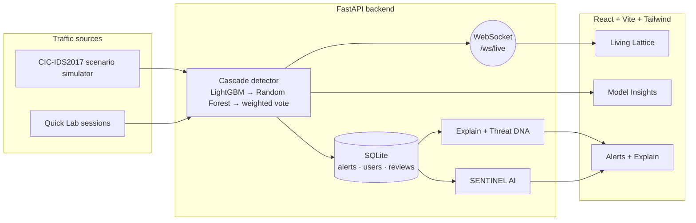

<div align="center">

```text
        ·       ·   ·       ·       ·
     ·───●───────●───●───────●───────●───·
        ╲│╲     ╱│╲ ╱│╲     ╱│╲     ╱│╱
         ●─╲───●─┼─●─┼─●───╱─┼─●───╱─●
        ╱│  ╲ ╱  │╳  │  ╲ ╱  │  ╲ ╱  │╲
     ·──●───●─●───●───●───●─●───●───●──●──·
        ╲│  ╱ ╲  │╳  │  ╱ ╲  │  ╱ ╲  │╱
         ●─╱───●─┼─●─┼─●───╲─┼─●───╲─●
        ╱│╱     ╲│╱ ╲│╱     ╲│╱     ╲│╲
     ·───●───────●───●───────●───────●───·
        ·       ·   ·       ·       ·
```

# C A S C A D Y X

**S I G N A L &nbsp; O B S E R V A T O R Y &nbsp; F O R &nbsp; N E T W O R K &nbsp; I N T R U S I O N S**

*A confidence-gated machine-learning cascade that decides, flow by flow, how much intelligence a packet stream deserves.*

<br>

[](https://cascadyx-rveq.onrender.com)


*Final Year Project &nbsp;·&nbsp; CIC-IDS2017 &nbsp;·&nbsp; detection, analysis and awareness only — it never blocks traffic and never attacks anything.*

</div>

---

## ◈ Contents

| | | |
|---|---|---|
| [◈ The idea](#-the-idea) | [◈ Instrument panel](#-instrument-panel) | [◈ Architecture](#-architecture) |
| [◈ The cascade](#-the-cascade) | [◈ Run it locally](#-run-it-locally) | [◈ Screenshots](#-screenshots) |
| [◈ Honest limits](#-honest-limits) | [◈ Documentation](#-documentation) | [◈ Repository map](#-repository-map) |

---

## ◈ The idea

Most ML intrusion detectors are a single model behind a single number. **Cascadyx** treats classification like triage:

> Cheap, confident answers leave early. Only genuinely ambiguous flows are escalated to a heavier council of models.

Each network flow from CIC-IDS2017 is sorted into one of **15 classes** (BENIGN plus 14 attack types) and then *shown* — on a 3D traffic lattice, in a per-alert explanation, and through an interactive machine that animates the cascade's own decision path. The goal is a console an evaluator can both **trust** and **understand**.

<table>
<tr>
<td width="33%" valign="top">

**◇ Detect**<br>
Three-tier cascade classifies every flow and streams verdicts live over WebSocket.

</td>
<td width="33%" valign="top">

**◇ Explain**<br>
Every alert can be opened to see *why* — ranked features against a benign baseline, plus a Threat DNA signature.

</td>
<td width="33%" valign="top">

**◇ Teach**<br>
Scenario simulator, isolated Attack Lab and an AI assistant turn detection into something a learner can poke at.

</td>
</tr>
</table>

---

## ◈ Instrument panel

The interface follows a **Signal Observatory** design language: dark glass, teal signal traces, and data-dense instruments built for desktop displays.

<table>
<tr>
<td width="50%" valign="top">

### ⬡ Living Lattice
A real-time 3D traffic visualisation with a **Threat Posture** gauge. Benign flows drift quietly; attacks light the lattice up.

</td>
<td width="50%" valign="top">

### ⬡ Threat Simulator
Replays labelled CIC-IDS2017 flows through the live detector using ready-made scenarios, at a rate you control.

</td>
</tr>
<tr>
<td width="50%" valign="top">

### ⬡ Attack Lab
**Quick Lab** runs prepared lab sessions from an isolated virtual lab network, with a Lab Theater showing Attacker → Victim traffic and the sensor tapping the link.<br>
**Live Lab** &nbsp;`Coming Soon`

</td>
<td width="50%" valign="top">

### ⬡ Model Insights + Cascade Machine
Benchmarks, confusion matrices, feature importances, SMOTE before/after, and an **interactive Cascade Machine** that walks a flow through every tier.

</td>
</tr>
<tr>
<td width="50%" valign="top">

### ⬡ Explain Verdict + Threat DNA
Per-alert XAI: top features weighted by deviation from the benign baseline, rendered as a **Threat DNA** radar signature.

</td>
<td width="50%" valign="top">

### ⬡ SENTINEL AI
An AI assistant for questions about alerts and the system, backed by a rule-based fallback so it still answers when the model is unavailable.

</td>
</tr>
<tr>
<td width="50%" valign="top">

### ⬡ Identity and Reviews
**Google Sign-In** (analyst accounts), role-based access, audit log, and a Reviews *Wall of Signals* for user feedback.

</td>
<td width="50%" valign="top">

### ⬡ Desktop gate + first-visit intro
Viewports under **1024 px** get a clear "built for desktop" screen; first-time visitors get a short animated introduction.

</td>
</tr>
</table>

---

## ◈ Architecture



| Layer | Technology |
|---|---|
| Backend | FastAPI, SQLModel, SQLite, JWT + Google sign-in, WebSocket |
| ML | scikit-learn, LightGBM, XGBoost, imbalanced-learn |
| Frontend | React, Vite, TypeScript, Tailwind CSS, Recharts, React Three Fiber |
| Hosting | Render (free tier) for the public demo |

---

## ◈ The cascade

```text
   flow ──▶ ┌────────────────────┐  p ≥ 0.85  ──▶  verdict (tier 1)
            │ TIER 1  LightGBM   │
            └─────────┬──────────┘
                      │ p < 0.85
                      ▼
            ┌────────────────────┐  p ≥ 0.85  ──▶  verdict (tier 2)
            │ TIER 2  Random     │
            │         Forest     │
            └─────────┬──────────┘
                      │ p < 0.85
                      ▼
            ┌────────────────────┐
            │ TIER 3  weighted   │ ──────────────▶  verdict (tier 3)
            │         vote       │
            └────────────────────┘
        P = 0.2·LightGBM + 0.3·RandomForest + 0.5·XGBoost
```

| Measured on held-out CIC-IDS2017 data | Result |
|---|---|
| Cascade accuracy (stratified 200k-flow sample) | **99.71 %** |
| Flows resolved at Tier 1 | **99.69 %** |
| Single models (LightGBM / RF / XGBoost) | 99.75 % / 99.58 % / 99.68 % |
| Backend test suite | **87 passed** |

> **Reported honestly:** macro-F1 is about 0.81 because the web-application classes (Brute Force, XSS, SQL Injection) have very few labelled examples. High headline accuracy is not the same as strong rare-class detection, and the docs say so plainly.

---

## ◈ Run it locally

**Prerequisites:** Python 3.10+, Node.js 18+, Git, and the trained model artifacts under `data/cache` (gitignored). Docker is not required.

### One command (Windows)

```powershell
.\scripts\run_demo.ps1
```

Builds `frontend/dist` if needed, then serves SPA + API + WebSocket from **http://127.0.0.1:8000**.

### Two processes (development)

```powershell
# Backend
cd backend
python -m venv venv
.\venv\Scripts\Activate.ps1
pip install -r requirements.txt
copy .env.example .env          # optional settings; never commit your .env
uvicorn app.main:app --reload --port 8000
```

```powershell
# Frontend (second terminal)
cd frontend
npm install
npm run dev                     # http://localhost:5173, proxies /api and WebSocket to :8000
```

### Handy commands

| Task | Command |
|---|---|
| Health check | `curl http://127.0.0.1:8000/api/health` |
| Backend tests | `cd backend; pytest` |
| Seed demo alerts (server running) | `cd backend; python -m app.ml.generate_test_alerts` |
| Production frontend build | `cd frontend; npm run build` |

Public deployment steps: [`docs/GO_LIVE.md`](docs/GO_LIVE.md). Presenting it in 5-7 minutes: [`docs/DEMO.md`](docs/DEMO.md).

---

## ◈ Live demo

<div align="center">

### **[cascadyx-rveq.onrender.com](https://cascadyx-rveq.onrender.com)**

Best on a **desktop browser, 1024 px or wider**.<br>
Hosted on a free tier that **sleeps when idle**: open it a couple of minutes before you need it. The first request may take 1-2 minutes to wake.

</div>

---

## ◈ Screenshots

No images are committed yet. Drop captures into `docs/images/` and uncomment the lines below.

<!--
| Living Lattice | Cascade Machine |
|---|---|
|  |  |

| Explain + Threat DNA | Attack Lab |
|---|---|
|  |  |
-->

| Slot | Suggested capture |
|---|---|
| `living-lattice.png` | Lattice mid-attack with the Threat Posture gauge raised |
| `cascade-machine.png` | Model Insights, a flow travelling through the tiers |
| `threat-dna.png` | Explain Verdict panel with the DNA radar |
| `attack-lab.png` | Quick Lab theater with the sensor tapping the link |

---

## ◈ Honest limits

Cascadyx is an **educational console, not a wire-speed IDS**. These constraints are deliberate and documented.

| Area | Reality |
|---|---|
| **Throughput** | Single-flow inference measured at about 44 flows/s; with in-process SQLite writes, sustained capacity is roughly **40 flows/s**, lower on the free tier. |
| **Free-tier hosting** | Render's free service **sleeps after about 15 minutes idle** and cold-starts in 1-2 minutes. |
| **Ephemeral data** | The free tier has no persistent disk: the SQLite database is rebuilt on sleep, redeploy or restart. Users, alerts, chats and reviews reset; nothing on the public site is permanent. |
| **Rare web attacks** | Brute Force, XSS and SQL Injection are weak classes (few training examples). |
| **Live Lab** | Shown as *Coming Soon*; Quick Lab is the working Attack Lab track. |
| **Devices** | Desktop only; narrower viewports are gated. |

Full list: [`docs/KNOWN_LIMITATIONS.md`](docs/KNOWN_LIMITATIONS.md).

---

## ◈ Documentation

| Read this | For |
|---|---|
| [`docs/FYP_PROJECT_COMPLETE.md`](docs/FYP_PROJECT_COMPLETE.md) | The complete project report: method, metrics, design, testing |
| [`docs/GO_LIVE.md`](docs/GO_LIVE.md) | Step-by-step free public deployment |
| [`docs/DEMO.md`](docs/DEMO.md) | 5-7 minute demonstration script and checklist |
| [`docs/DEPLOY.md`](docs/DEPLOY.md) | Deployment reference and capacity notes |
| [`docs/ARCHITECTURE.md`](docs/ARCHITECTURE.md) | System, data-flow, cascade and UI diagrams |
| [`docs/USER_MANUAL.md`](docs/USER_MANUAL.md) | Feature walkthrough |
| [`docs/API_SUMMARY.md`](docs/API_SUMMARY.md) | Key endpoints |
| [`docs/TEST_CASES.md`](docs/TEST_CASES.md) | Test cases aligned to pytest and manual demos |
| [`docs/THESIS_DRAFT.md`](docs/THESIS_DRAFT.md) · [`docs/VIVA_SHEET.md`](docs/VIVA_SHEET.md) | Thesis draft and examiner talking points |
| [`docs/GOOGLE_OAUTH.md`](docs/GOOGLE_OAUTH.md) | Google Sign-In setup |

---

## ◈ Repository map

```text
Final_Year_Project/
├── backend/            FastAPI app: API, cascade inference, WebSocket, tests
├── frontend/           React + Vite + TypeScript + Tailwind UI
├── data/               datasets and model cache (mostly gitignored)
├── deploy/             slim model bundle used by the public deployment
├── docs/               report, demo, deploy, architecture, viva material
├── scripts/            run_demo.ps1 and helper scripts
└── CLAUDE.md           developer commands and style guide
```

<div align="center">

<sub>◈ &nbsp; Cascadyx &nbsp;·&nbsp; Signal Observatory &nbsp;·&nbsp; built to detect, explain and teach &nbsp; ◈</sub>

</div>
