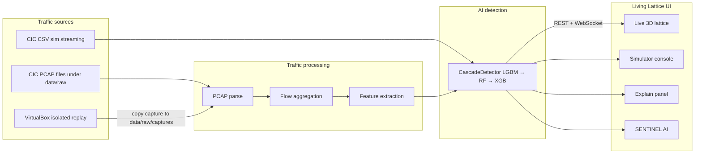
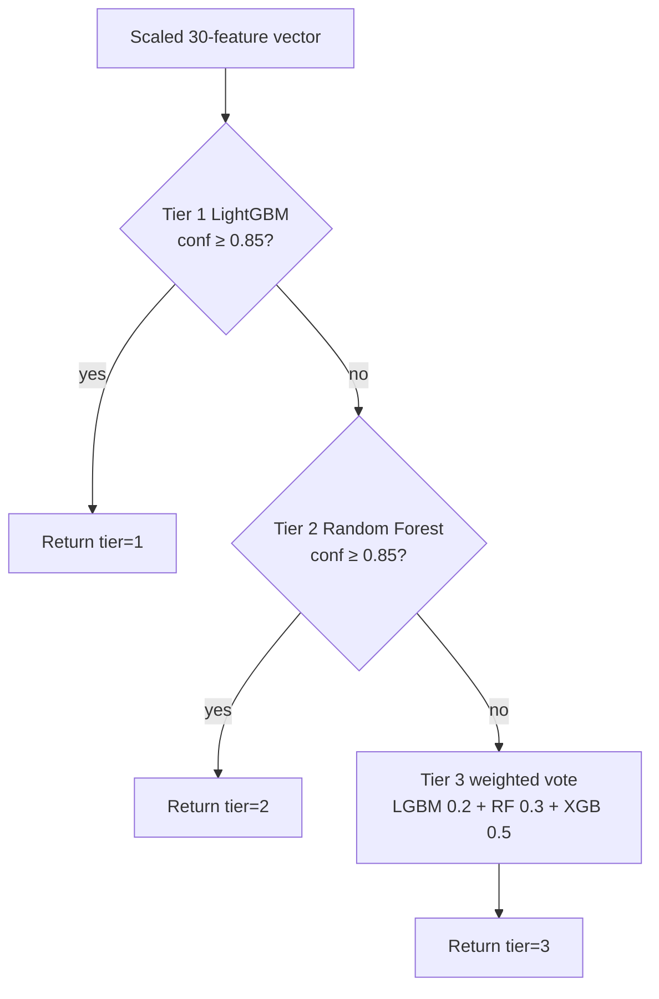
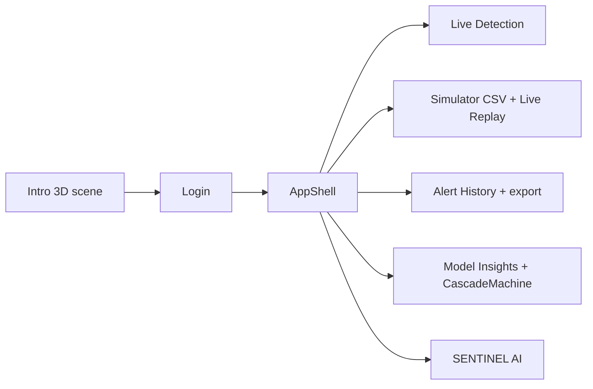
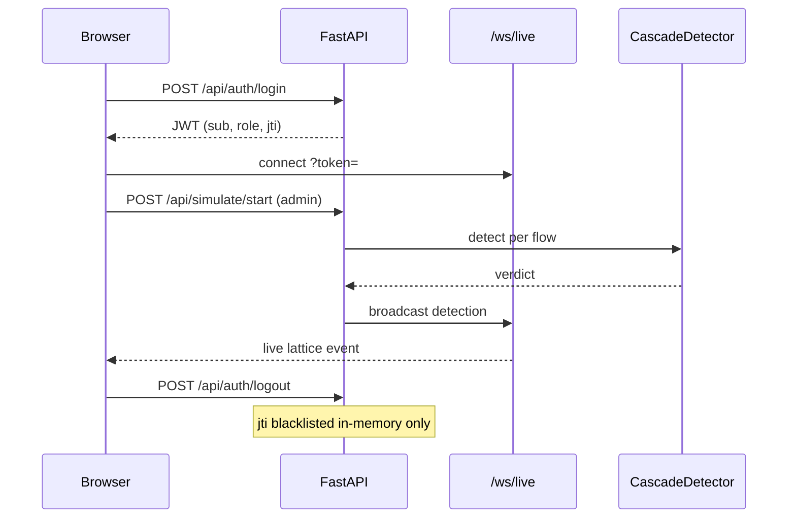

# Cascadyx — Architecture

**Product:** Cascadyx — Cybersecurity Threat Simulator Powered by AI  
**Sources of truth:** `Plan.md`, `backend/app/ml/cascade.py`, `backend/app/simulator/`, `docs/ISOLATED_REPLAY.md`, `FYP_REPORT_DATA.md`

Cascadyx is a **detection + analysis + awareness** system. It does **not** auto-block attacks. Traffic is **recorded CIC-IDS2017** (CSV or PCAP), never live attack tooling against real networks.

---

## 1. System context



| Layer | Stack | Key paths |
|-------|--------|-----------|
| API / WS | FastAPI, SQLModel/SQLite, JWT | `backend/app/main.py` |
| ML | LightGBM, Random Forest, XGBoost | `backend/app/ml/cascade.py`, `data/cache/models/*.joblib` |
| CSV sim | Test-split row streaming | `backend/app/simulator/simulator.py` |
| PCAP | Scapy-based parse → flows → features | `backend/app/ml/` PCAP pipeline + `POST /api/pcap/analyze` |
| UI | React + Vite + R3F + Framer Motion | `frontend/src/pages/*`, `frontend/src/components/lattice/` |

---

## 2. End-to-end data flow

```mermaid
flowchart TB
  subgraph mid [Mode A — Mid path]
    A1[CIC labelled CSV cache] --> A2[SimulationEngine.start]
    A2 -->|rate-capped flows| A3[CascadeDetector.detect]
  end

  subgraph final [Mode B — Final path]
    B1[PCAP under data/raw] --> B2[Parse packets]
    B2 --> B3[Bidirectional flow build]
    B3 --> B4[30 selected features]
    B4 --> B5[detect / detect_batch]
    B6[VBox tcpreplay + capture] -->|manual copy| B1
  end

  A3 --> C[Alert if non-BENIGN]
  B5 --> C
  C --> D[(SQLite alerts)]
  C --> E[/ws/live broadcast]
  E --> F[Live Detection lattice]
  D --> G[History / CSV·PDF export]
```

**CSV vs PCAP roles (do not conflate):**

| Role | CSV path | PCAP path |
|------|----------|-----------|
| Training / mid eval | CIC GeneratedLabelledFlows → prepare → SMOTE → train → `data/cache` | Not used for training |
| Simulation | Stream labelled test rows (10 scenarios) | Batch analyze or Live Replay of recorded packets |
| Isolation demo | Not required | VirtualBox Internal Network + `tcpreplay` → host `data/raw/captures/` — see [`ISOLATED_REPLAY.md`](ISOLATED_REPLAY.md) |

---

## 3. Cascade detector

Production variant is always **`mid_baseline`** (`data/cache/models/*.joblib`). Hardened artifacts under `models/hardened/` are experimental and are **never** auto-loaded (`resolve_model_dir` in `cascade.py`).



| Fact | Value | Source |
|------|-------|--------|
| Escalation threshold | 0.85 | `CascadeDetector.__init__` |
| Tier-1 share (200k sample) | ~99.69% of flows | `FYP_REPORT_DATA.md` §4.1 |
| Why LightGBM first | Highest overall accuracy (~99.75%), **not** speed — RF is faster at inference | `cascade.py` docstring; chat FAQ in `main.py` |
| DDoS / PortScan | Almost entirely Tier 1; T2/T3 idle | §4.1 (DDoS: 9047 / 8 / 0) |
| Single-flow throughput | ~**44** flows/s | `SINGLE_FLOW_THROUGHPUT_FPS`; §4.5 |
| Batch throughput (advertised) | ~**120** flows/s | `BATCH_THROUGHPUT_FPS` |

Hardening comparison (`data/cache/metrics/comparison.json`): all three models **regressed** on macro-F1 → recommendation **`keep_baseline`**.

---

## 4. Living Lattice UI composition



| Route | Page | Lattice / viz |
|-------|------|----------------|
| `/` (first visit) | `Intro.tsx` + `IntroScene` | 3D scaffold: Simulate → Detect → Explain |
| `/` (dashboard) | `LiveDetectionPage` | `LiveAttackLattice` |
| `/simulator` | `SimulatorPage` | CSV scenarios + Live Replay controls |
| `/history` | `AlertHistoryPage` | Filters, pagination, admin export |
| `/insights` | `ModelInsightsPage` | Metrics, CM, `CascadeMachine` |
| `/ai` | `AiAssistantPage` | Hybrid Nebius / rule-based chat |

---

## 5. Auth, roles, and live feed



Sensitive routes (simulate, replay, PCAP analyze, alert export, audit logs) require **admin**. Analysts can view live feed, history, insights, and chat. JWT revoke details: [`KNOWN_LIMITATIONS.md`](KNOWN_LIMITATIONS.md).

---

## Related docs

- Demo script: [`DEMO.md`](DEMO.md)
- VirtualBox lab (external steps): [`ISOLATED_REPLAY.md`](ISOLATED_REPLAY.md)
- Honest limits: [`KNOWN_LIMITATIONS.md`](KNOWN_LIMITATIONS.md)
- API list: [`API_SUMMARY.md`](API_SUMMARY.md)
