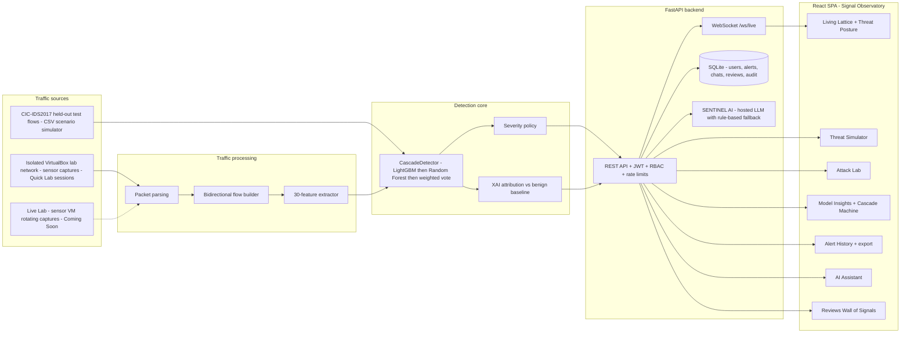
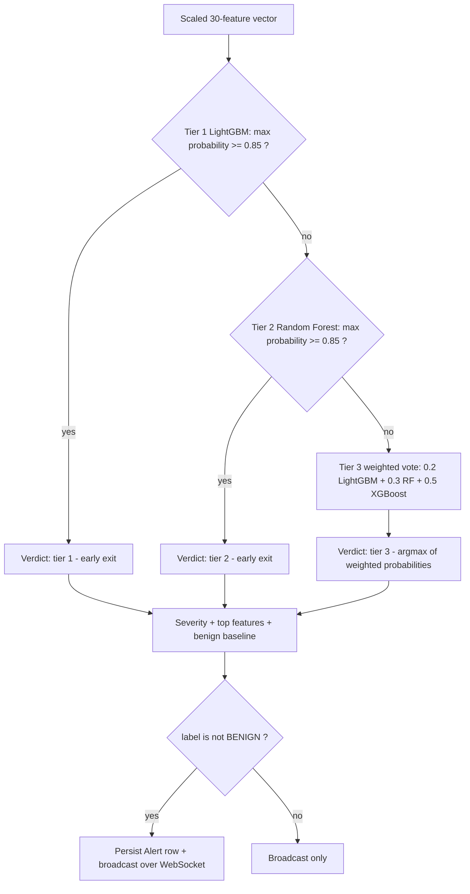
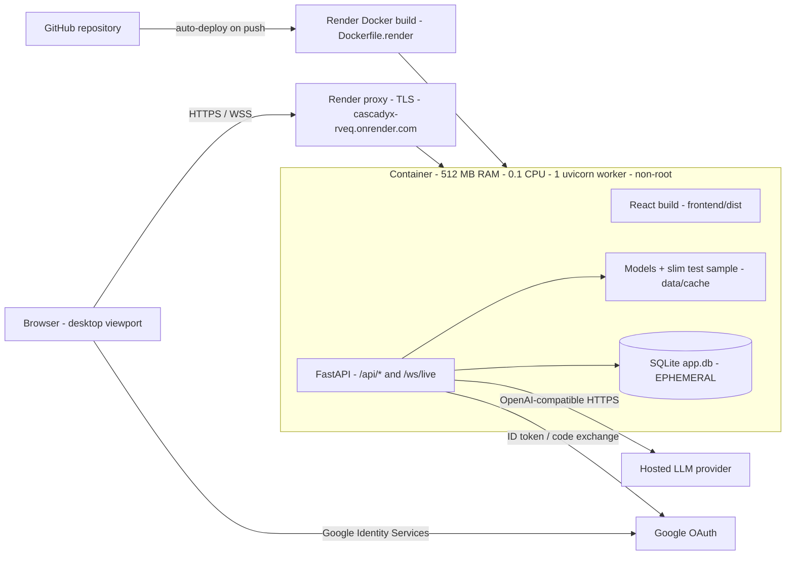
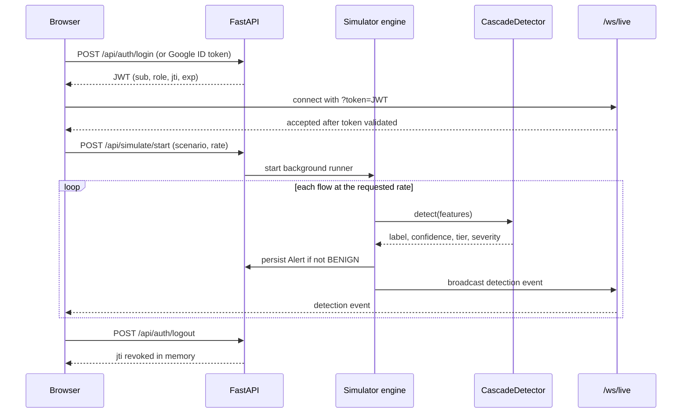

# Cascadyx — A Cascade Intrusion Detection System with an Educational Threat-Simulation Console

**Final Year Project (FYP) — Complete Project Document / Report Source**

> This file is the single source document for the FYP report. Every chapter below is written in formal report tone so it can be copied into the corresponding thesis chapter. All numbers are taken from the repository's measured artefacts (`data/cache/metrics/*`, `FYP_REPORT_DATA.md`, `scripts/report/out_*.json`) or from commands re-run while preparing this document. Where something was **not** measured, it says so.

---

## 0. Title Page

| Field | Value |
|---|---|
| **Project title** | Cascadyx — Cybersecurity Threat Simulator Powered by AI |
| **Short name** | **Cascadyx** (cascade IDS) |
| **Project type** | Final Year Project (FYP), BS(IT) |
| **Institution** | Bahria University, Karachi |
| **Supervisor** | Mr. Muhammad Shahzad |
| **Team** | Muhammad Hammad Raza, Yasir Hussain, Muhammad Izhan Khan |
| **Domain** | Network intrusion detection, machine learning, explainable AI, security education |
| **Dataset** | CIC-IDS2017 (Canadian Institute for Cybersecurity) |
| **Core technique** | Three-tier confidence-gated cascade: LightGBM → Random Forest → weighted vote (LightGBM 0.2 / Random Forest 0.3 / XGBoost 0.5) |
| **Tech stack** | Python, FastAPI, SQLModel/SQLite, scikit-learn, LightGBM, XGBoost; React 19, Vite, Tailwind CSS, Recharts, React Three Fiber |
| **Public demo** | <https://cascadyx-rveq.onrender.com> (free tier; sleeps when idle — see §15) |
| **Report date** | November 2026 |

---

## Table of Contents

1. [Abstract](#1-abstract)
2. [Introduction and Motivation](#2-introduction-and-motivation)
3. [Problem Statement](#3-problem-statement)
4. [Aims and Objectives](#4-aims-and-objectives)
5. [Scope and Limitations](#5-scope-and-limitations)
6. [Related Work and Background](#6-related-work-and-background)
7. [Dataset: CIC-IDS2017](#7-dataset-cic-ids2017)
8. [Methodology: The Three-Tier Cascade](#8-methodology-the-three-tier-cascade)
9. [System Architecture](#9-system-architecture)
10. [Backend Implementation](#10-backend-implementation)
11. [Frontend Implementation](#11-frontend-implementation)
12. [Authentication, Authorisation and AI Quota](#12-authentication-authorisation-and-ai-quota)
13. [Functional Modules in Detail](#13-functional-modules-in-detail)
14. [Traffic Sources and Pipeline Fidelity](#14-traffic-sources-and-pipeline-fidelity)
15. [Deployment](#15-deployment)
16. [Testing and Verification](#16-testing-and-verification)
17. [Results and Evaluation](#17-results-and-evaluation)
18. [User Guide](#18-user-guide)
19. [Ethical Considerations](#19-ethical-considerations)
20. [Future Work](#20-future-work)
21. [Conclusion](#21-conclusion)
22. [References](#22-references)
- [Appendix A — API Reference](#appendix-a--api-reference)
- [Appendix B — Database Schema](#appendix-b--database-schema)
- [Appendix C — Configuration (names only)](#appendix-c--configuration-variable-names-only)
- [Appendix D — Repository Structure and Code Size](#appendix-d--repository-structure-and-code-size)
- [Appendix E — Viva Quick Answers](#appendix-e--viva-quick-answers)
- [Appendix F — Notes for the Student (remove before submission)](#appendix-f--notes-for-the-student-remove-before-submission)

---

## 1. Abstract

Network intrusion detection systems (IDS) based on machine learning routinely report very high headline accuracy on public datasets, yet they are rarely accessible to students and they seldom explain *why* a flow was flagged. **Cascadyx** is a web-based cascade IDS and educational threat-simulation console that addresses both gaps. It classifies network flows from the CIC-IDS2017 benchmark into 15 classes (BENIGN plus 14 attack types) using a **three-tier, confidence-gated cascade**: a LightGBM screener (Tier 1), a Random Forest validator (Tier 2) and a weighted-vote expert ensemble of LightGBM, Random Forest and XGBoost with weights 0.2/0.3/0.5 (Tier 3). A flow leaves the cascade at the first tier whose top-class probability reaches **0.85**; otherwise it escalates.

The models were trained on 2,827,876 cleaned flows (30 Random-Forest-selected features; SMOTE-capped minority oversampling at 20,000 samples per class; stratified 80/20 split). On the held-out 565,576-flow test partition, the individual models achieve accuracies of 99.75% (LightGBM), 99.58% (Random Forest) and 99.68% (XGBoost). On a stratified 200,000-flow sample, the whole cascade reaches **99.71% accuracy**, resolving **99.69% of flows at Tier 1**, with a measured sustained single-flow throughput of **44.35 flows/s**. Results are reported honestly: macro-F1 is only ≈0.81 because the three web-application attack classes (Brute Force, XSS, SQL Injection) have very few labelled examples; pure web-attack traffic is classified with only 61.15% accuracy, and Tier 3, which receives only the hardest 0.27% of flows, is correct only 28.4% of the time.

The system is delivered as a FastAPI backend (SQLModel/SQLite, JWT and Google sign-in, role-based access control, audit log, rate limiting, WebSocket live detections) and a React/Vite/Tailwind frontend with a "Signal Observatory" design language. Modules include a Living Lattice 3D traffic visualisation with a Threat Posture gauge, a CSV-driven Threat Simulator with 10 scenarios, an Attack Lab (Quick Lab sessions from an isolated virtual lab network), Model Insights with an interactive "AI Cascade Machine", per-alert Explain Verdict with a Threat DNA signature, the SENTINEL AI assistant, alert history with CSV/PDF export, and a Reviews "Wall of Signals". The backend test suite contains 87 automated tests, all passing at the time of writing. A free public deployment on Render demonstrates the system over HTTPS, with documented free-tier limitations (idle sleep, ephemeral database). Cascadyx performs detection, analysis and awareness only; it never blocks traffic and never launches attacks.

**Keywords:** intrusion detection, cascade classifier, LightGBM, Random Forest, XGBoost, CIC-IDS2017, explainable AI, SMOTE, FastAPI, React, security education.

---

## 2. Introduction and Motivation

### 2.1 Background

Enterprise networks face a continuous stream of denial-of-service floods, reconnaissance scans, credential-guessing campaigns, web-application attacks and botnet command-and-control traffic. Signature-based IDS tools detect known patterns but lag behind new variants; machine-learning approaches generalise better and have achieved very high accuracy on benchmark datasets such as CIC-IDS2017. For students, however, three practical barriers remain:

1. **Access** — production IDS stacks are complex to install, and live attack tooling is risky and legally sensitive.
2. **Opacity** — a classifier that outputs only a label gives learners no insight into *which* traffic characteristics drove the decision.
3. **Cost versus accuracy** — running the largest model on every flow is wasteful when the overwhelming majority of flows are easy to classify.

### 2.2 Motivation

Cascadyx was motivated by the proposal's three pillars: **Simulate** attacks in a controlled, offline environment, **Detect** them with an AI/ML cascade, and **Visualise** the results in a real-time, educational dashboard with Explainable AI (XAI). The cascade design is the project's central technical idea: spend inexpensive computation on the large majority of clear-cut flows and reserve additional model capacity for the small residue of ambiguous ones.

A secondary motivation is *honest engineering*. The project deliberately reports weak classes, non-promoted experiments and measured throughput so that a reader can distinguish what the system does well from what it does not.

---

## 3. Problem Statement

Existing educational resources and public IDS demonstrations tend to suffer from one or more of the following problems:

- They present a **single model** and a single accuracy number, hiding class imbalance and weak minority classes.
- They give **no explanation** of individual verdicts, so a learner cannot connect a detection to traffic features.
- They require **live attack tooling** or complex lab setup, which is unsuitable for classroom use and potentially unsafe.
- They are **not interactive**: results are static notebooks rather than a live console that shows traffic arriving, being classified and being explained.

**Problem:** *How can a cost-aware, explainable ML intrusion-detection pipeline over CIC-IDS2017 be built and presented in an interactive, safe, web-based environment that reports its own strengths and weaknesses honestly?*

---

## 4. Aims and Objectives

### 4.1 Aim

To design, implement, evaluate and deploy **Cascadyx**, a web-based cascade intrusion-detection system and threat-simulation console that detects, explains and visualises network attacks using recorded CIC-IDS2017 traffic, without ever attacking a real network.

### 4.2 Objectives

| # | Objective | Realised in |
|---|---|---|
| O1 | Build a reproducible data pipeline for CIC-IDS2017 (cleaning, leakage removal, feature selection, class-imbalance handling, scaling). | §7 |
| O2 | Train three complementary classifiers and design a confidence-gated three-tier cascade with early exit. | §8 |
| O3 | Quantify individual-model and whole-cascade performance, including per-class, per-tier and per-scenario behaviour, and report weaknesses honestly. | §17 |
| O4 | Provide a secure REST + WebSocket backend with authentication, role-based access control, auditing and rate limiting. | §10, §12 |
| O5 | Provide an interactive, desktop-class web console (live visualisation, simulator, lab, insights, history/export). | §11, §13 |
| O6 | Provide Explainable AI: per-verdict feature attribution against a benign baseline and a Threat DNA signature. | §13.5 |
| O7 | Provide an AI assistant (SENTINEL AI) with a deterministic offline fallback and per-user quota. | §12.3, §13.6 |
| O8 | Support safe, isolated-lab traffic ingestion (Quick Lab; Live Lab planned) alongside labelled CSV simulation. | §13.3, §14 |
| O9 | Deploy a public HTTPS demonstration at zero cost with documented hardening and limitations. | §15 |
| O10 | Verify the system with an automated test suite and end-to-end checks. | §16 |

---

## 5. Scope and Limitations

### 5.1 In scope

- Network-level threat detection on **CIC-IDS2017** (TCP/IP enterprise "General IT" scope).
- A three-tier ML cascade, XAI, live and historical visualisation, a CSV scenario simulator, an isolated-lab Attack Lab (Quick Lab), an AI assistant and a reviews page.
- Local demonstration and a free public HTTPS deployment.

### 5.2 Out of scope (proposal guardrails)

- **No active defence:** Cascadyx never blocks or mitigates traffic.
- **No live attacks by the application:** Cascadyx itself never launches attack tools.
- **No live penetration testing**, no IoT-specific IDS, no merging of unrelated datasets for training.

### 5.3 Limitations (consolidated)

| Area | Limitation | Consequence / mitigation |
|---|---|---|
| **Client devices** | **Desktop-only gate.** Viewports narrower than 1024 px (and coarse-pointer narrow devices) are blocked by `DesktopGate`; the console is not designed for phones or tablets. | Use a desktop browser or widen the window to ≥ 1024 px. |
| **Free-tier hosting** | The public site runs on Render's free web service (512 MB RAM, 0.1 CPU, one worker). It **sleeps after ≈15 minutes idle**, with a cold start of roughly 1–2 minutes. | Open the URL a few minutes before a demonstration. |
| **Ephemeral database** | The free tier has no persistent disk: the SQLite file is rebuilt on every sleep→wake, redeploy or restart. Users, alerts, chats, reviews and AI counters are lost; `admin` is re-seeded. | Acceptable for a demo; nothing on the public site should be treated as permanent. |
| **Throughput / capacity** | Single-flow cascade inference was measured at **44.35 flows/s** on the development machine. Together with in-process SQLite alert writes and one shared simulator, practical sustained capacity is on the order of **≈40 flows/s**; the UI caps stream rate at 44 and presets at 40. On the free tier it is lower. | Not a wire-speed IDS; it is an educational console. |
| **Single simulator** | One in-memory simulator per process: **one simulation at a time for all users** (CSV and lab sessions share a mutex). | Run one scenario at a time. |
| **Live Lab** | **Live Lab is shown as "Coming soon"** in the interface (`LIVE_LAB_ENABLED = false`). It requires a Sensor VM delivering rotating captures and is not deployed publicly. | Quick Lab is the working Attack Lab track. |
| **Web-application attacks** | Web Attack – Brute Force / XSS / SQL Injection are weak (per-class F1 0.18–0.50) owing to scarce labelled samples. | Reported openly; hardening experiments did not fix it (§17.6). |
| **Tier-3 accuracy** | Tier 3 resolves only the hardest residue and is correct ≈28% of the time. | A "best effort on ambiguous flows", not a high-accuracy oracle. |
| **Feature fidelity** | Models were trained on CICFlowMeter-style CSV features; features recomputed from raw packets are an approximation, so verdicts on lab-session traffic can differ from ground truth. | Unvalidated lab scenarios are tagged **Experimental**; real cascade output is always displayed. |
| **Token revocation** | Logout revocation is an in-memory blacklist; a server restart clears it. | Documented trade-off for a single-process deployment. |
| **Schema migration** | No migration framework (e.g. Alembic); idempotent `PRAGMA`/`ALTER TABLE` statements in `init_db()`. SQLite only. | Postgres not supported without code changes. |
| **Scaling** | No horizontal scaling; single uvicorn worker. | Educational demonstration only. |

---

## 6. Related Work and Background

### 6.1 Intrusion detection

An IDS monitors network or host activity to identify malicious behaviour (Scarfone and Mell, 2007). *Signature-based* systems match known patterns; *anomaly-based* systems model normal behaviour and flag deviations. Machine-learning IDS research has produced a large body of work (Buczak and Guven, 2016), but Sommer and Paxson (2010) caution that ML-based detection is harder to deploy than in other domains because of the high cost of errors, the diversity of normal traffic and the difficulty of evaluation. Axelsson (2000) shows that the base-rate fallacy makes even small false-positive rates operationally expensive when attacks are rare.

### 6.2 Benchmark datasets

CIC-IDS2017 (Sharafaldin et al., 2018) provides labelled benign and attack traffic with flow features extracted by CICFlowMeter (Lashkari et al., 2017). It is widely used but is known to contain labelling and construction issues (Engelen et al., 2021), and its web-attack classes are extremely small. These issues directly shape the results in §17.

### 6.3 Ensembles and classifier cascades

Ensemble methods combine multiple learners to improve accuracy and robustness (Dietterich, 2000). Gradient-boosted trees (LightGBM — Ke et al., 2017; XGBoost — Chen and Guestrin, 2016) and Random Forests (Breiman, 2001) are consistently strong on tabular flow features. A **cascade** of classifiers, popularised by Viola and Jones (2001) for object detection and studied for multistage classification by Kaynak and Alpaydin (2000), evaluates cheap classifiers first and invokes more expensive ones only on uncertain inputs. Cascadyx applies this idea to flow classification with a **probability-confidence gate** rather than a binary accept/reject stage.

### 6.4 Class imbalance

CIC-IDS2017 is severely imbalanced (from 9 Heartbleed training rows to ≈1.8 million BENIGN rows). Synthetic Minority Over-sampling (SMOTE; Chawla et al., 2002), as implemented in imbalanced-learn (Lemaître et al., 2017), interpolates new minority samples. Cascadyx uses a *capped* SMOTE (§7.5) after observing that full balancing destabilised LightGBM training.

### 6.5 Explainability

Post-hoc explanations such as SHAP (Lundberg and Lee, 2017) attribute predictions to features. Cascadyx uses a lighter, model-agnostic presentation: feature importance weighted by how far each flow's feature value deviates from the benign baseline (§13.5), which is cheap enough to compute per alert in a live console.

### 6.6 Positioning of Cascadyx

Cascadyx does not claim a new detection algorithm. Its contribution is the **integration** of a measured, honest cascade with a safe, interactive, explainable and deployable educational console, and the rigorous reporting of where the approach succeeds (volumetric attacks) and where it does not (web-application attacks).

---

## 7. Dataset: CIC-IDS2017

### 7.1 Source and variant

The project uses the **CIC-IDS2017 "GeneratedLabelledFlows"** CSV packaging (8 daily files, 85 columns each). Two redundant packagings exist on disk (`GeneratedLabelledFlows` and `MachineLearningCSV`); the loader selects only one (the larger directory group) to avoid schema mismatches that would inject NaN columns when concatenating.

### 7.2 Classes

The fitted label encoder defines 15 classes (index order):

| Idx | Class | Idx | Class |
|---|---|---|---|
| 0 | BENIGN | 8 | Heartbleed |
| 1 | Bot | 9 | Infiltration |
| 2 | DDoS | 10 | PortScan |
| 3 | DoS GoldenEye | 11 | SSH-Patator |
| 4 | DoS Hulk | 12 | Web Attack – Brute Force |
| 5 | DoS Slowhttptest | 13 | Web Attack – Sql Injection |
| 6 | DoS slowloris | 14 | Web Attack – XSS |
| 7 | FTP-Patator | | |

### 7.3 Cleaning (row counts from the loader's own functions)

| Stage | Rows |
|---|---|
| Raw rows across 8 files | 3,119,345 |
| Fully empty padding rows removed (Thursday Web-Attacks file only) | 288,602 |
| Rows with remaining NaN (including those created by ±∞ replacement) removed | 2,867 |
| **Cleaned total** | **2,827,876** |

Other handling: files are read with a latin-1 fallback (one file contains a Windows en-dash byte that breaks UTF-8); ±∞ values become NaN before removal. Six identifier columns are dropped to prevent the model memorising hosts or time: `Flow ID`, `Source IP`, `Destination IP`, `Source Port`, `Destination Port`, `Timestamp`.

### 7.4 Train/test split — honesty statement

- A single **stratified 80/20 split** with `random_state=42`: 2,262,300 training rows and **565,576 test rows**.
- The test partition is **never** oversampled or used to fit the scaler, feature selector or SMOTE; the scaler is fitted on the (post-SMOTE) training set only and applied with `.transform()` to the test set.
- There is **no k-fold cross-validation**; reported metrics come from this single held-out split. Differences between models of a few hundredths of a percent should therefore not be over-interpreted.
- Test-class counts follow the natural distribution, so rare classes have tiny support (Heartbleed 2, SQL Injection 4, Infiltration 7). Per-class metrics for those classes are statistically fragile.
- The CSV Threat Simulator streams rows from this same held-out test split (not the training data).

### 7.5 Class imbalance handling (SMOTE, capped)

Training-partition class counts before and after SMOTE:

| Class | Before | After |
|---|---:|---:|
| BENIGN | 1,817,055 | 1,817,055 |
| Bot | 1,565 | 20,000 |
| DDoS | 102,420 | 102,420 |
| DoS GoldenEye | 8,234 | 20,000 |
| DoS Hulk | 184,099 | 184,099 |
| DoS Slowhttptest | 4,399 | 20,000 |
| DoS slowloris | 4,637 | 20,000 |
| FTP-Patator | 6,348 | 20,000 |
| Heartbleed | 9 | 20,000 |
| Infiltration | 29 | 20,000 |
| PortScan | 127,043 | 127,043 |
| SSH-Patator | 4,717 | 20,000 |
| Web Attack – Brute Force | 1,206 | 20,000 |
| Web Attack – Sql Injection | 17 | 20,000 |
| Web Attack – XSS | 522 | 20,000 |
| **Total** | **2,262,300** | **2,450,617** |

Design decision: SMOTE raises every class below 20,000 samples to exactly 20,000 (`k_neighbors = min(5, min_class_count − 1)`). Full balancing to the majority class (`sampling_strategy="auto"`) was tried first; it forced ~200,000× duplication of the 9-row Heartbleed class and destabilised LightGBM (accuracy fell as boosting rounds increased). The cap preserves SMOTE's purpose without manufacturing a degenerate synthetic manifold. **SMOTE cannot invent information that the data lacks**: web-attack classes remain weak (§17.5).

### 7.6 Feature set (`features.json`)

Starting from 78 candidate columns (85 − `Label` − 6 identifiers), a `RandomForestClassifier(n_estimators=50, max_depth=12, random_state=42)` was fitted on a stratified 100,000-row subsample of the training split; the **top 30 features by importance** were kept. `features.json` stores them as an ordered list:

| Rank | Feature | Rank | Feature | Rank | Feature |
|---:|---|---:|---|---:|---|
| 1 | Max Packet Length | 11 | Fwd Packet Length Max | 21 | Bwd Packets/s |
| 2 | Packet Length Variance | 12 | Init_Win_bytes_forward | 22 | Bwd Header Length |
| 3 | Packet Length Std | 13 | Total Fwd Packets | 23 | Fwd IAT Max |
| 4 | Avg Bwd Segment Size | 14 | Bwd Packet Length Std | 24 | PSH Flag Count |
| 5 | Bwd Packet Length Max | 15 | Packet Length Mean | 25 | Idle Min |
| 6 | Total Length of Bwd Packets | 16 | Avg Fwd Segment Size | 26 | Init_Win_bytes_backward |
| 7 | Subflow Fwd Bytes | 17 | Fwd Packet Length Mean | 27 | Fwd Header Length |
| 8 | Subflow Bwd Bytes | 18 | Bwd Packet Length Mean | 28 | Flow IAT Max |
| 9 | Average Packet Size | 19 | Flow Bytes/s | 29 | act_data_pkt_fwd |
| 10 | Total Length of Fwd Packets | 20 | Fwd Header Length.1 | 30 | Fwd IAT Std |

Features are scaled with a `StandardScaler` (fitted on the post-SMOTE training set; persisted to `scaler.joblib`). Importance *scores* are not stored in `features.json`; the live Random Forest exposes them through `/api/models/metrics`, and the Model Insights page plots them.

### 7.7 Two roles of data in the project

| Role | Data | Used for |
|---|---|---|
| Training / evaluation | CIC-IDS2017 labelled CSV flows | Train the three models; held-out test split for metrics |
| Simulation | Held-out test-split rows (CSV simulator) and lab-session captures (Attack Lab) | Streaming demonstrations through the same cascade |

The two layers are never merged for training.

---

## 8. Methodology: The Three-Tier Cascade

### 8.1 Model training

All three models are trained on the same 2,450,617 × 30 scaled training matrix (`random_state=42` everywhere). Training used the full set (the 3,000,000-row subsampling ceiling was not triggered).

| Model | Hyperparameters | Train time | Model file |
|---|---|---:|---:|
| LightGBM | `n_estimators=150, num_leaves=15, min_child_samples=50, reg_lambda=1.0` | 96.6 s | 3.95 MB |
| Random Forest | `n_estimators=50, max_depth=12` | 64.3 s | 9.55 MB |
| XGBoost | `n_estimators=100, max_depth=6, learning_rate=0.1` | 332.5 s | 3.35 MB |

The LightGBM settings were tuned *after a real training failure*: the default `num_leaves=31` combined with SMOTE's synthetic minority clusters caused LightGBM to stop on "no further splits with positive gain" and collapse accuracy to 0.37–0.82. A smaller `num_leaves`, larger `min_child_samples` and L2 regularisation restored accuracy to ≈0.997. The SMOTE cap and the LightGBM parameters were therefore co-tuned.

### 8.2 Cascade logic

For each flow, the 30 features are assembled, scaled, and evaluated tier by tier:

1. **Tier 1 — LightGBM ("fast screener").** If the maximum class probability ≥ **0.85**, return that class with `tier = 1`.
2. **Tier 2 — Random Forest ("explainable validator").** If its maximum class probability ≥ **0.85**, return that class with `tier = 2`.
3. **Tier 3 — weighted vote ("expert ensemble").** Compute
   `P = 0.2 · P_LightGBM + 0.3 · P_RandomForest + 0.5 · P_XGBoost`
   and return `argmax(P)` with `tier = 3`. This tier always decides.

Every result records `tier`, `tier_name`, confidence, severity, the top contributing features and the benign baseline values for those features. The 0.85 threshold is fixed in the running system: the Python API accepts a per-call override, but no HTTP endpoint exposes it.

### 8.3 Design rationale

| Question | Answer |
|---|---|
| Why a cascade? | Most flows are easy; spend the least computation on them and escalate only uncertain flows. 99.69% of sampled flows exit at Tier 1. |
| Why is LightGBM first? | Chosen for **highest overall accuracy** (99.75%), **not** for speed — Random Forest is actually the fastest per-prediction model (≈0.0017 ms versus ≈0.013 ms in `summary.json`). |
| Why Random Forest second? | Fast, stable and naturally explainable (feature importances). |
| Why weighted voting last? | Combines all three models on the genuinely ambiguous residue. XGBoost carries the largest weight (0.5) because it is the most recall-oriented (macro-recall 0.893). |
| Why a 0.85 gate? | A conservative operating point: a tier's verdict is final only when it is at least 85% sure; otherwise the next tier gets a say. |

### 8.4 Severity policy

A base severity is assigned by class (Critical: Bot, DDoS, all four DoS variants, Heartbleed, Infiltration; High: FTP-Patator, SSH-Patator, all three Web Attack classes; Medium: PortScan; Info: BENIGN). If the cascade confidence is **below 0.70**, the severity is lowered by one level (Critical→High→Medium→Low; Low is the floor; Info never changes).

### 8.5 Experimental hardening (not promoted)

A reduced-budget `RandomizedSearchCV` ("hardening") experiment was run (search on 40,000 samples, 4 iterations per model, final training on 100,000 samples). All three models **regressed** in macro-F1 (§17.6), so the recommendation is `keep_baseline`. The production cascade always loads the baseline models; hardened artefacts are labelled *experimental / non-production* and are never loaded for inference.

### 8.6 Inference engineering notes

- Models, scaler and encoder are loaded once at start-up and cached in application state.
- Cached large arrays are opened with `np.load(..., mmap_mode="r")` (memory-mapped) rather than copied into RAM.
- A vectorised `detect_batch` path (advertised ≈120 flows/s) is used for capture analysis; the simulator paces one flow at a time (≈44 flows/s), so UI rate caps stay honest.

---

## 9. System Architecture

### 9.1 Overall architecture



### 9.2 Cascade flow



### 9.3 Deployment architecture (free tier)



### 9.4 Authentication and live-detection sequence



### 9.5 Technology summary

| Layer | Technology |
|---|---|
| ML | scikit-learn, LightGBM, XGBoost, imbalanced-learn, pandas, NumPy, joblib |
| Backend | FastAPI, Uvicorn, SQLModel (SQLAlchemy 2.0), SQLite, python-jose (JWT), passlib/bcrypt, slowapi, ReportLab (PDF), google-auth |
| AI assistant | OpenAI-compatible client to a hosted instruction-tuned LLM; built-in rule-based answers |
| Frontend | React 19, Vite 8, TypeScript, Tailwind CSS 4, Recharts, React Three Fiber / three.js, Framer Motion, Axios, React Router 7, lucide-react |
| Packaging | Docker (`Dockerfile.render`), Render Blueprint (`render.yaml`) |

---

## 10. Backend Implementation

The backend is a single FastAPI application (`backend/app/main.py`) plus routers for the lab, cascade demo and reviews. It exposes roughly **52 HTTP endpoints and one WebSocket** (Appendix A).

### 10.1 Application structure

| Module | Responsibility |
|---|---|
| `main.py` | App factory, lifespan start-up, auth, predict, XAI, chat, conversations, metrics, alerts, simulator, replay, capture analysis, audit logs, WebSocket |
| `config.py` | Environment-driven settings; JWT secret fail-safe; CORS allow-list; `PUBLIC_MODE`; `validate_public_mode()` |
| `ml/cascade.py` | `CascadeDetector` (load assets, `detect`, `detect_batch`, trace mode, top-feature attribution) |
| `ml/severity.py` | Base-severity map and confidence downgrade rule |
| `ml/train.py`, `ml/harden.py` | Training runner and the experimental hardening search |
| `data/loader.py` | Cleaning, leakage removal, feature selection, SMOTE, scaling, split |
| `simulator/` | `SimulationEngine` (CSV streaming), replay mixin (capture streaming), scenario registry |
| `pcap/` | Capture parser → flow builder → feature extractor → pipeline |
| `services/` | Audit writer, lab manifest and sensor watcher, curated cascade-demo flows, LLM client |
| `routers/` | `lab.py`, `cascade_demo.py`, `reviews.py` |
| `auth/` | Password hashing, JWT creation/validation/revocation, `require_roles`, Google OAuth helpers |
| `db/` | SQLModel tables, engine/session, idempotent migrations |
| `ws_manager.py` | WebSocket connection manager, detection broadcast, 5-second heartbeat |
| `middleware.py`, `rate_limit.py`, `static_ui.py` | Request logging/IDs, security headers, shared limiter, SPA static mount |

### 10.2 Start-up lifecycle

1. Validate public-mode secrets (refuse to boot if unsafe).
2. Create tables / run idempotent migrations (`init_db()`).
3. Seed the `admin` user if no admin exists (password from `ADMIN_SEED_PASSWORD`, otherwise a one-time random value printed locally; never logged in public mode).
4. Load the cascade detector and the simulator index maps once.
5. Start the 5-second WebSocket heartbeat task and, optionally, the Live Lab sensor watcher.

### 10.3 Database (SQLModel / SQLite)

Seven tables: `User`, `Alert`, `Conversation`, `ChatMessage`, `Review`, `ReviewHelpful`, `AuditLog` (Appendix B). All access uses SQLModel sessions via FastAPI dependencies. The database path is `data/cache/app.db` by default. Schema evolution on existing files is handled by guarded `ALTER TABLE` / `CREATE INDEX IF NOT EXISTS` statements. The test suite replaces `DATABASE_URL` with an isolated temporary SQLite file before the app is imported.

### 10.4 Real-time detections over WebSocket

`/ws/live` broadcasts JSON events to all connected clients:

- `detection` — label, confidence, tier, tier name, top features with benign averages, raw features, severity, synthetic display IPs/ports, and (for non-BENIGN) `alert_id` and `source_scenario`.
- `heartbeat` — every 5 seconds.

Browsers cannot set custom headers on a WebSocket handshake, so the JWT is passed as `?token=…` and **validated before the connection is accepted**; missing, invalid or revoked tokens are closed with policy-violation code 1008. The frontend hook reconnects automatically and ignores events from a replaced (stale) socket, which fixed a duplicate-event bug observed under React StrictMode.

### 10.5 Role-based access control (RBAC)

| Role | How obtained | Capabilities |
|---|---|---|
| `analyst` | Self-registration or Google sign-in (always analyst) | Detection, simulator, Quick Lab, capture analysis, alerts and export, insights, XAI, AI assistant (quota), reviews |
| `admin` | Seeded account only | Everything above, **plus** audit-log access, Live Lab sensor toggle, review moderation (hide/delete/export), unlimited AI queries |

A `require_roles(...)` dependency factory enforces roles; the role is always read from the database row, never trusted from the JWT claim alone.

### 10.6 Audit log

Sensitive actions append an `AuditLog` row (timestamp, user, role, action, JSON detail, client IP). Audited actions include `simulate.start`/`stop`, replay start/stop, `pcap.analyze`, `alerts.export`, `lab.start`/`stop`, `lab.sensor.enable`/`disable`, and review moderation/export. `GET /api/audit-logs` is admin-only.

### 10.7 Rate limiting

Per-client-IP limits with `slowapi` (proxy headers are trusted on the public host so limits apply to the real client):

| Endpoint group | Limit |
|---|---|
| `POST /api/auth/login` | 5 / minute |
| `POST /api/auth/register`, Google auth endpoints | 10 / minute |
| `POST /api/predict` | 60 / minute |
| `POST /api/xai/explain`, `POST /api/chat` | 30 / minute |
| `GET /api/alerts/export`, `POST /api/simulate/start`, `POST /api/simulate/replay/start`, `POST /api/lab/sessions` | 20 / minute |
| `POST /api/pcap/analyze` | 10 / minute |
| `POST /api/reviews` | 5 / minute |
| `PUT /api/reviews/mine` | 10 / minute |
| Review helpful vote | 60 / minute |
| `GET /api/cascade/demo/next` | 120 / minute |

### 10.8 Public-mode hardening (`PUBLIC_MODE=1`)

| Control | Behaviour |
|---|---|
| API docs | `/docs`, `/redoc`, `/openapi.json` are disabled (404) |
| Security headers | HSTS, `X-Content-Type-Options: nosniff`, `X-Frame-Options: SAMEORIGIN`, strict referrer policy on every response (no CSP, deliberately, because Google Identity Services loads remote scripts) |
| Upload block | Multipart capture upload is refused (403) |
| Fail-fast secrets | The server **refuses to start** if `JWT_SECRET` < 32 characters or `ADMIN_SEED_PASSWORD` < 12 characters |
| Admin password | Never written to logs in public mode |
| CORS | Explicit allow-list (local dev origins + public base URL + configured extras), not a wildcard |
| Container | Runs as a non-root user; one worker; thread fan-out disabled |
| Health | `/api/health` for the platform; `/api/ready` reports detector/UI/public-mode state |

### 10.9 Error handling

A uniform JSON error envelope (`error`, `detail`, `status_code`, `request_id`) is returned for validation errors, HTTP exceptions and unhandled exceptions; stack traces are never returned to clients. Every request is logged with a short request ID and duration.

### 10.10 Reports and export

`GET /api/alerts/export` produces a filtered **CSV** or **PDF** session report (ReportLab) and writes an audit entry.

---

## 11. Frontend Implementation

### 11.1 Stack and conventions

React 19 functional components with hooks, TypeScript, Tailwind CSS 4 and Recharts; the 3D scenes use React Three Fiber (three.js) with Framer Motion for UI motion. Pages are lazily loaded to keep the first paint light. Reusable UI primitives live in `src/components/ui`.

### 11.2 "Signal Observatory" design language

The visual system is defined by CSS design tokens (`styles/tokens.css`) with light and dark themes:

- **Brand:** indigo accent (`#4C3F91`) with a copper secondary (`#C97A3F`), Inter and Space Grotesk typography, glass surfaces, soft aurora backgrounds.
- **Severity palette (fixed across themes):** Critical `#D03B3B`, High `#EC835A`, Medium `#FAB219`, Low `#8A8F98`, Info `#0CA30C`.
- **Tier palette (fixed):** Tier 1 `#2A78D6`, Tier 2 `#EB6834`, Tier 3 `#1BAF7A`; a sequential blue ramp for the confusion-matrix heat-map.
- Each navigation area has its own identity colour; meaning-bearing colours (severity, tier) are not changed by the theme so that they stay consistent.
- Accessibility and performance: `prefers-reduced-motion` is honoured, WebGL is probed with a static fallback, and pointer parallax is handled outside React state.

### 11.3 First-visit Intro and brand splash

- **First visit** in a browser (tracked by `localStorage` key `cx-intro-seen-v2`): a ≈8-second skippable **Intro** with three beats — *Simulate* ("Run an attack in a sealed lab"), *Detect* ("The cascade catches it"), *Explain* ("Then it tells you why") — ending in the Cascadyx brand moment. Space/Enter/→ advance; Esc skips.
- **Returning visitors:** a ≈1.2-second brand splash.
- `?intro=1` forces the full intro; "Watch the intro again" replays it as an overlay so a half-typed login form is not destroyed.

### 11.4 Login

The Login page is Google-forward: **Continue with Google** (Google Identity Services, with a redirect fallback) creates an analyst account instantly, and a username/password form is available for existing accounts (including `admin`). If Google reports an unregistered origin, the page shows the exact origin that must be registered. Accounts are created through Google or the `/api/auth/register` endpoint.

### 11.5 AppShell and navigation

`AppShell` provides a collapsible sidebar, header status chrome (Threat Posture badge, WebSocket status, simulation-active indicator, sound toggle, light/dark theme toggle) and animated page transitions. Navigation groups:

| Group | Pages |
|---|---|
| Monitor | Live Detection |
| Operate | Threat Simulator, Attack Lab |
| Analyze | Alert History, Model Insights |
| Assist | AI Assistant, Reviews |

A public-deployment notice (`PublicNotice`) honestly states the capacity limits on non-localhost hosts. A **sign-out confirmation** dialog protects against accidental logout.

### 11.6 DesktopGate

`DesktopGate` wraps the whole app. Below **1024 px** (or on a coarse-pointer narrow device) it replaces the UI with a "built for desktop displays" dialog; resizing to a desktop width unlocks it automatically. This is a deliberate scope decision so that the data-dense console and 3D scenes remain usable.

### 11.7 State and data flow

`DashboardLayout` owns shared state (WebSocket events, simulation status, XAI and export modals, theme/sound) and exposes it through a context to the page components. Live events travel through a lightweight event bus into the 3D lattice so that high event rates do not re-render the whole console.

---

## 12. Authentication, Authorisation and AI Quota

### 12.1 Password and Google sign-in

- **Passwords** are hashed with bcrypt (cost 12 via passlib); login is rate-limited (5/min).
- **Google sign-in** verifies a Google Identity Services ID token (issuer, audience, expiry) server-side, or exchanges an authorisation code with the client secret held only on the server; the user is created or linked by Google `sub` as an **analyst**. The OAuth client secret is never sent to the browser. Google requires the exact page origin to be registered (see §15.4 and `docs/GOOGLE_OAUTH.md`).

### 12.2 JWT sessions

- Tokens are **HS256** JWTs with `sub`, `role`, a unique `jti` and an expiry.
- Sessions are **long-lived**: the token is stored in browser `localStorage` and survives browser restarts **until the user explicitly signs out** (after a confirmation dialog) or the token expires. The lifetime is configured by `ACCESS_TOKEN_EXPIRE_DAYS` (code default **365 days**; the Render Blueprint presets a shorter value — see Appendix F).
- **Logout** revokes the token's `jti` in an in-memory set; the client also clears local storage even if the network call fails. A server restart clears the revocation list (documented limitation).
- `JWT_SECRET` fails safe: if unset locally, a random per-process secret is generated (never a hard-coded string); in public mode the server refuses to start without a strong secret.

### 12.3 AI quota

| Role | AI (LLM) questions |
|---|---|
| Analyst / Google user | **10 successful AI replies per account (lifetime)**, configurable via `AI_QUERY_LIMIT` |
| Admin | **Unlimited** (role read from the database, not the JWT) |

Only successful LLM replies are counted; built-in rule-based answers are free. `GET /api/chat/quota` reports usage, and the UI shows the remaining count ("*n* of 10 AI questions left"). When the quota is exhausted, the assistant explains that common topics (cascade architecture, simulator presets, threat types) still work via built-in answers.

---

## 13. Functional Modules in Detail

### 13.1 Living Lattice and Threat Posture (Live Detection)

The Live Detection page is the primary monitoring view.

- **Living Lattice (v2)** is a WebGL "network observatory" built with React Three Fiber. It renders hosts (including a lab-VM zone) and animates **real WebSocket detection events** as arcs of traffic between real source and destination addresses; hostile flows glow in their severity colour, with higher severity appearing hotter. A badge shows the live state and hostile-flows-per-second. An empty-state overlay is shown before traffic arrives.
- **Threat Posture** is a separate gauge panel beside the lattice (it never overlays it). The score is the mean severity weight of the live events in the rolling window, normalised to 0–100: Info = 0, Low = 1, Medium = 2, High = 3, Critical = 4, score = round(mean/4 × 100). Bands: **SECURE** (≤ 30), **ELEVATED** (31–60), **UNDER ATTACK** (> 60). A sparkline shows the last 20 scores.
- Supporting panels: packet/attack counters, cascade-tier distribution, volumetric timeline, threat distribution charts, the live feed, and a coaching panel ("What you're seeing now") that explains severity colours and cascade tiers while a simulation runs.

### 13.2 Threat Simulator (CSV scenarios)

The simulator streams **real labelled flows from the held-out test split** through the live cascade at a requested rate, saving non-BENIGN verdicts as alerts and broadcasting every verdict over WebSocket.

| Scenario | Source classes | Notes |
|---|---|---|
| DoS Attack | DoS Hulk, GoldenEye, slowloris, Slowhttptest | |
| DDoS Attack | DDoS | |
| Brute Force | FTP-Patator, SSH-Patator | |
| Web Attacks | Web Attack – Brute Force / SQL Injection / XSS | Weakest scenario (61% accuracy) |
| Port Scan | PortScan | |
| Botnet Activity | Bot | |
| Infiltration | Infiltration | Only 7 test rows; round-robin selection |
| Heartbleed | Heartbleed | Only 2 test rows; round-robin selection |
| Mixed Attack | All 14 attack classes | Runtime mix: 20% BENIGN / 80% attack |
| Benign Baseline | BENIGN | Used to read the false-positive rate |

Controls: scenario cards with an educational "What you will learn" story, rate presets (UI maximum 44 flows/s; server-side abuse ceiling 500), optional duration, start/stop, and live status (packets, attacks, tier breakdown). Pacing uses deadline-based timing so the observed rate matches the requested rate (e.g. 20 requested → 20.0 observed; 40 → 37.5 for CSV). Display IPs/ports are derived deterministically **after** classification purely for presentation; they never feed the model.

### 13.3 Attack Lab — Quick Lab (and Live Lab: Coming Soon)

The Attack Lab teaches how an attack looks end-to-end across an isolated lab network, in two tracks:

| | **Quick Lab** | **Live Lab** |
|---|---|---|
| Status | **Working** | **Coming Soon** (gated in the UI) |
| Traffic | A stored **lab session**: sensor-view traffic from an isolated VirtualBox lab network (Attacker VM → Victim VM) | Rotating captures delivered by a **Sensor VM** on a VirtualBox Internal Network while the user runs commands in their own VMs |
| Pipeline | Capture → packet parsing → bidirectional flows → 30 features → cascade → alerts + live WebSocket | Same, per finished capture chunk |
| User action | One click; the user does not launch the attack | The user runs lab commands inside their own isolated VMs |
| Safety | Read-only; Cascadyx never launches any tool | Pre-start isolation checklist; supervisor sign-off; never bridged to a real network |

Quick Lab scenarios are described on cards (name, category, plain-English blurb, expected labels, duration) and include volumetric floods, a port-scan sweep, credential guessing, web-application probing, botnet beaconing and an everyday mixed session. A **"Lab theater"** visualises Attacker → Victim traffic with the Sensor tapping the link. Scenarios whose behaviour has not been validated against the cascade are tagged **Experimental**, and the cascade's real verdict is always shown — including BENIGN where that is what the cascade returns. Starting and stopping a session is audited (`lab.start`, `lab.stop`).

### 13.4 Model Insights, "Why a Cascade?" and the Cascade Machine

- **Model Insights ("Cascade Benchmarks")** shows the three-model comparison table (accuracy, macro precision, macro F1, latency, training time), confusion-matrix heat-maps, live Random Forest feature importances, SMOTE before/after charts, and the hardening comparison with its `keep_baseline` recommendation and the web-attack caveat.
- **Why a Cascade?** is a four-step explanation: the cost/accuracy problem; the 0.85 gate and early exit; why this order; and the honest numbers (≈99.7% finish at Tier 1; Tier 3 right only ≈28% on its hard residue).
- **AI Cascade Machine** animates a flow moving through Tier 1 → Tier 2 → Tier 3 against the 0.85 gate. **Demo traffic** mode plays curated **real held-out test flows** served by `GET /api/cascade/demo/next` (guided or random, optionally pinned to a tier), with real per-tier scores. Because natural traffic is ≈99.7% Tier 1, the playlist is curated to include Tier 2 and Tier 3 exits — **including deliberate misses**, so the demonstration is not cherry-picked. Demo traffic is read-only: it writes no alerts, sends no WebSocket events and does not touch the simulator.

### 13.5 Explain Verdict and Threat DNA

For any alert, **Explain verdict** calls `POST /api/xai/explain`, which re-runs the cascade for that flow and returns:

- the verdict, confidence, tier and tier name;
- the **top features** ranked by model importance weighted by deviation from the **benign baseline** (precomputed per-feature benign averages), each with the flow's value, the benign average and the impact;
- a plain-English explanation (LLM prose with a deterministic template fallback);
- the severity.

The **Threat DNA signature** is a radar chart of the flow's normalised 30-feature profile compared with the normal baseline, revealed with a one-shot animation, so that a learner can *see* how an attack's feature shape differs from benign traffic.

### 13.6 SENTINEL AI assistant

SENTINEL AI is a security-operations assistant for Cascadyx questions (cascade design, scenarios, attack types, "explain my last alert").

- **Hybrid design:** a hosted instruction-tuned LLM reached through an OpenAI-compatible API, with a deterministic rule-based answer set that always works offline and in tests.
- **Branding:** the assistant presents itself only as Cascadyx's SENTINEL AI; its system prompt forbids naming any AI vendor, platform or model provider, and the interface shows no provider branding.
- **Conversations:** saved threads (rename, pin, delete, owner-only), plus an **Incognito** mode that never persists a conversation. A generation counter in the UI discards late responses if the user switches context mid-reply.
- **Quota:** per §12.3.

### 13.7 Alert History and export

A filterable, paginated alert table (attack type, tier, severity, date range) with per-row **Explain verdict**, and CSV/PDF export of the filtered set (audited).

### 13.8 Reviews — "Wall of Signals"

A feedback page in which each account may publish **one editable review** (rating, title ≤ 80 characters, body ≤ 1000, would-recommend, suggestion ≤ 500, and tags from a fixed vocabulary: Cascade, Lattice, Lab, Explainability, AI Assistant, Design, Performance). Users can mark reviews *helpful* (one vote per user per review); admins can hide, delete and export reviews, all audited. All user text is stored as plain text with control characters stripped and rendered as escaped text. The page provides user-feedback evidence for the report.

### 13.9 Learning coach

A `SimLearningCoach` component explains, in plain words, what the learner is about to see ("What you will learn") and what is happening now ("What you're seeing now"), and nudges the learner towards Explain, History and the AI Assistant.

---

## 14. Traffic Sources and Pipeline Fidelity

Cascadyx uses two honest traffic sources that feed the *same* cascade:

| | CSV simulator | Quick Lab (lab session) |
|---|---|---|
| Input | Labelled held-out CIC-IDS2017 test rows (precomputed CICFlowMeter features) | Captured lab-session traffic that is parsed, assembled into flows and converted to the 30 model features |
| Ground truth | Yes (CIC labels) | No CIC ground-truth labels |
| Live? | No — streamed from the test split | No — a stored session; Live Lab is the only live track and is Coming Soon |
| Role | Reliable demonstrations with known truth | A one-click demonstration of the packet-to-verdict pipeline |

**Fidelity statement.** The models were trained on CICFlowMeter-style features, whereas the capture path recomputes the 30 features from raw packets. These are close approximations, not identical, so a lab session's verdict can be BENIGN or a neighbouring class. Cascadyx displays the cascade's real verdict rather than the scenario's expected label. This is a documented limitation, not hidden behaviour.

---

## 15. Deployment

### 15.1 Local

- **One-command demo (Windows):** `.\scripts\run_demo.ps1` builds `frontend/dist` if needed and serves the SPA, API and WebSocket from <http://127.0.0.1:8000> (single origin, no CORS friction).
- **Dual-process development:** `uvicorn app.main:app --reload --port 8000` plus `npm run dev` (Vite on 5173; proxies `/api`; the WebSocket connects to the backend).

### 15.2 Free public deployment (Render)

| Item | Value |
|---|---|
| Platform | Render free web service (Docker, 512 MB RAM, 0.1 CPU, Singapore region) |
| URL | **<https://cascadyx-rveq.onrender.com>** (automatic HTTPS) |
| Cost | $0 |
| Source | GitHub repository; auto-deploy on push |
| Packaging | `render.yaml` (Blueprint) + `Dockerfile.render` (Node 22 UI build stage; Python 3.14 runtime with pinned ML libraries) |
| Models | Slim committed bundle `deploy/data/` (≈23 MB: production models, scaler/encoder, metrics, curated demo flows, a per-class-capped test sample, Quick Lab session files), built by `scripts/build_deploy_bundle.py` |
| Process | One uvicorn worker (SQLite + in-process WebSocket manager + one simulator), non-root user, proxy headers trusted |
| Health | `/api/health` (platform check), `/api/ready` |

A full local setup is *not* needed to use the public site; the 52 GB raw dataset and the Sensor VM are not deployed.

### 15.3 `PUBLIC_MODE` and HTTPS

`PUBLIC_MODE=1` (set by the image and Blueprint) enables the hardening in §10.8. TLS is terminated by Render's proxy; the app trusts forwarded headers, adds HSTS and serves everything same-origin. The live deployment was smoke-tested: `/api/health` ok, `/` returns the SPA, `/docs` returns 404, and security headers are present.

### 15.4 Google OAuth origins

In the Google Cloud Console web client:

- **Authorized JavaScript origins:** `https://cascadyx-rveq.onrender.com`
- **Authorized redirect URIs:** `https://cascadyx-rveq.onrender.com/api/auth/google/callback`
- Local development additionally registers `http://127.0.0.1:5173`, `http://localhost:5173`, `http://127.0.0.1:8000` and `http://localhost:8000` (these are different origins to Google).
- The consent screen is published ("In production") with only the non-sensitive scopes `openid`, `email`, `profile`.
- `GET /api/auth/google/config` lists the required origins for verification. The redirect URI is derived automatically from the platform URL.

### 15.5 Free-tier behaviour users must know

1. **Sleeps after ≈15 minutes** without traffic; the next request takes ≈1–2 minutes (models reload on 0.1 CPU).
2. **Ephemeral database:** users, alerts, chats, reviews and AI counters reset on sleep, redeploy or restart; `admin` is re-seeded; Google users are recreated on next sign-in.
3. **One simulation at a time** for all users; keep demonstration rates low (≈5–10 flows/s).
4. Inference on 0.1 CPU is slower than the 44 flows/s measured locally; the capacity has **not been load-tested** on Render.
5. Secrets are set in the platform environment, never in git.

---

## 16. Testing and Verification

### 16.1 Automated backend tests (pytest)

The suite runs against an **isolated temporary database and the real trained cascade models**, without a separately running server. Re-run while preparing this document:

> **87 tests collected — 87 passed, 0 failed** (≈86 s; the only messages are deprecation warnings, chiefly `datetime.utcnow()`).

| Test module | Tests | Focus |
|---|---:|---|
| `test_api_predict` | 2 | `/api/predict` auth gate; real verdict shape |
| `test_cascade` | 2 | Real models load; benign and threat flows classified |
| `test_cascade_demo` | 4 | Trace shape; auth gate; guided cycle with **no alert side effects**; tier filter and validation |
| `test_chat` | 9 | Rule-based answers; provider hidden in status; AI quota (rule-based answers do not count, exhaustion rejected, increments on success); admin unlimited; explain-last-alert |
| `test_conversations` | 4 | Conversation CRUD, owner isolation, incognito does not persist, auth required |
| `test_exports` | 6 | SMOTE stats; CSV and PDF export |
| `test_google_auth` | 7 | Config exposes client ID but never the secret; origin diagnostics; ID-token sign-in creates/reuses analyst; password login still works |
| `test_lab` | 6 | Auth gate; scenario catalogue; unknown/unavailable scenario handling; neutral scenario wording; Quick Lab session lifecycle; admin-only sensor toggle |
| `test_pcap_pipeline` | 4 | Feature list matches cache; flow builder merges bidirectional flows with aligned features; cascade accepts extracted features; small-slice smoke test |
| `test_phase5_rbac_audit_batch` | 11 | RBAC, audit-log writes, admin-only audit endpoint, metrics/hardening fields, mid-baseline loading, batch detection, refusal to promote hardened models |
| `test_phase6_hardening` | 8 | Capture-analysis API; path-escape rejection; uniform error envelope; rate limits; logout revocation; health; analyst RBAC |
| `test_public_mode_validation` | 4 | Fail-fast on weak secrets in public mode |
| `test_replay` | 4 | Status mode fields; replay lifecycle; path-escape rejection; mutex with the CSV simulator |
| `test_reviews` | 2 | Auth gate; review lifecycle and helpful votes |
| `test_severity_endpoints` | 2 | Severity persisted and exposed |
| `test_simulator` | 4 | Start/stop lifecycle, validation, rate cap |
| `test_token_expiry_config` | 2 | Token lifetime configuration |
| `test_websocket` | 5 | Missing/invalid/revoked token rejected; broadcast delivered; reconnect contract |
| `test_xai` | 1 | Attributions with benign averages |
| **Total** | **87** | |

(`docs/TEST_CASES.md` maps a 50-row test-case table onto these tests and the manual demonstrations.)

### 16.2 End-to-end (E2E) checks — themes

Browser-driven end-to-end checks were carried out on the running application at desktop width (≥ 1024 px). The themes covered, all of which **passed** in the recorded runs:

| Theme | Checks |
|---|---|
| **Shell and gating** | Desktop gate appears below 1024 px and unlocks on resize; build (`npm run build`) succeeds |
| **First-visit experience** | Intro plays and can be skipped; routing to Login after the intro |
| **Authentication** | Login page (Google button and password form); admin password login; sign-out confirmation (Cancel keeps session, Confirm signs out); reload while signed in restores the session |
| **Live monitoring** | Live Detection loads, lattice renders, WebSocket shows connected |
| **Simulation** | Select scenario → start → status updates → stop → idle |
| **Capture replay** | Replay of a benign lab session completed cleanly (164 packets → 18 flows → 0 attacks), demonstrating honest BENIGN output |
| **History and insights** | Alert History filtering and pagination; Model Insights and Cascade Machine render |
| **AI** | AI Assistant answers; quota indicator shown ("7 of 10 AI questions left"); **no provider branding** anywhere in the DOM |
| **Explainability** | Explain verdict from the UI and API returns attributions and prose |

A subsequent set of defects found during E2E testing was fixed: a critical-alert banner overlapping the Logout button, the AI identity prompt (provider names forbidden), and a stray chart-measurement artefact in page text.

**Public deployment smoke test** (`https://cascadyx-rveq.onrender.com`): health ok; SPA served (200); `/docs`, `/redoc`, `/openapi.json` → 404; Google sign-in configuration enabled with a valid client-ID shape and the correct redirect URI; desktop gate and intro/login pages work; HSTS, `nosniff`, frame and referrer headers present; protected endpoints return 401 without a token. Logged-in checks on the live site (admin login, live simulation, Quick Lab, Reviews, AI) were **not** automated in that run and should be confirmed manually before the demonstration.

### 16.3 Simulator and Living-Lattice verification summary

Every scenario was launched at rate 10 from the Threat Simulator and the **Live Detection feed and Living Lattice** were inspected (lattice badge sampled each second, feed rows, and a pixel capture of the canvas).

**Threat Simulator (10 scenarios) — all passed:**

| Scenario | Verdicts observed on the lattice and feed |
|---|---|
| DoS | DoS Hulk with some GoldenEye; Critical |
| DDoS | Every row DDoS; Critical |
| Brute Force | FTP-Patator and SSH-Patator; High |
| Web Attacks | XSS (Medium) and Brute Force (High), occasional BENIGN |
| Port Scan | Every row PortScan; Medium |
| Botnet | Bot; Critical |
| Infiltration | Infiltration; Critical, mixed with BENIGN |
| Heartbleed | Every row Heartbleed; Critical |
| Mixed Attack | A mix of DoS, DDoS, PortScan, Heartbleed, XSS, Patator and BENIGN |
| Benign Baseline | Zero hostile flows; all BENIGN/Info (one of 79 flows flagged in one run) |

**Quick Lab (lab sessions, 7 scenarios):** the DDoS flood, port-scan and mixed-session scenarios behaved as expected; the web-probing and credential-guessing scenarios were flagged mainly as Web Attack – Brute Force with some DoS GoldenEye (no XSS), a direct illustration of the feature-fidelity limitation in §14; the **botnet-beaconing** scenario produced only BENIGN verdicts and remains tagged *Experimental*.

**Defects found and fixed during this verification:**

1. *Duplicate live events* — every detection reached the lattice twice (160 events for 80 detections) because a stale WebSocket's late close handler opened a second connection under React StrictMode. A stale-socket guard in `useLiveSocket.ts` fixed it (76 events for 75 detections afterwards).
2. *Requested rate not honoured* — requested rates of 10–40 produced ≈6 flows/s because each loop slept a full interval after processing. Deadline-based pacing was introduced (Quick Lab requested 8/10/20/40 → observed ≈8/10.0/20.3/42.1 flows/s; CSV `port_scan` 20 → 20.0; `ddos` 40 → 37.5) and replay now classifies in batches off the event loop.
3. *Mixed DDoS + port-scan session showed no DDoS phase* — flows that never close were emitted only at the end of the capture; flows are now ordered by capture start time (at rate 8, 150 DDoS flows then 429 PortScan, 1 BENIGN over a 90-second session).

### 16.4 Other test artefacts

- Whole-cascade measurement scripts and raw outputs under `scripts/report/` (200,000-flow stratified pass: 4,509.5 s).
- Code-size and structure statistics in Appendix D.

---

## 17. Results and Evaluation

All numbers below are from `data/cache/metrics/summary.json`, the cached confusion matrices and `scripts/report/out_*.json`. No number has been rounded up or selected favourably.

### 17.1 Individual model performance (565,576-flow held-out test split)

| Model | Accuracy | Macro precision | Macro recall | Macro F1 | Mean latency (ms/flow) | Train time (s) |
|---|---:|---:|---:|---:|---:|---:|
| LightGBM | 0.99749 | 0.8389 | 0.8826 | 0.8435 | 0.0130 | 96.6 |
| Random Forest | 0.99576 | 0.8117 | 0.8632 | 0.8141 | 0.0017 | 64.3 |
| XGBoost | 0.99681 | 0.8154 | 0.8927 | 0.8348 | 0.0059 | 332.5 |

Weighted-average F1, ROC-AUC, calibration curves and cross-validation scores were **not computed**. The high accuracy is dominated by BENIGN (80% of the test set); **macro-F1 (≈0.81–0.84) is the more honest summary** of performance across all 15 classes.

### 17.2 Per-class results

Per-class precision and recall were derived from the cached confusion matrices (standard formulas; F1 cross-checked against the stored values). Support is the test-split count.

| Class | Support | LightGBM P | LightGBM R | **LightGBM F1** | **RF F1** | **XGB F1** |
|---|---:|---:|---:|---:|---:|---:|
| BENIGN | 454,265 | 0.9999 | 0.9974 | 0.9987 | 0.9976 | 0.9982 |
| Bot | 391 | 0.6382 | 0.9744 | 0.7713 | 0.7394 | 0.7525 |
| DDoS | 25,605 | 0.9997 | 0.9994 | 0.9996 | 0.9988 | 0.9994 |
| DoS GoldenEye | 2,059 | 0.9927 | 0.9956 | 0.9942 | 0.9812 | 0.9908 |
| DoS Hulk | 46,025 | 0.9979 | 0.9996 | 0.9988 | 0.9946 | 0.9984 |
| DoS Slowhttptest | 1,100 | 0.9447 | 0.9936 | 0.9685 | 0.9670 | 0.9663 |
| DoS slowloris | 1,159 | 0.9957 | 0.9931 | 0.9944 | 0.9974 | 0.9948 |
| FTP-Patator | 1,587 | 0.9987 | 0.9994 | 0.9991 | 0.9962 | 0.9987 |
| Heartbleed | 2 | 1.0000 | 1.0000 | 1.0000 | 1.0000 | 1.0000 |
| Infiltration | 7 | 1.0000 | 0.5714 | 0.7273 | 0.7273 | 0.7692 |
| PortScan | 31,761 | 0.9939 | 0.9996 | 0.9967 | 0.9966 | 0.9967 |
| SSH-Patator | 1,180 | 1.0000 | 0.9992 | 0.9996 | 0.9849 | 0.9996 |
| **Web Attack – Brute Force** | 301 | 0.3785 | 0.6312 | **0.4732** | 0.3086 | 0.4278 |
| **Web Attack – Sql Injection** | 4 | 0.5000 | 0.5000 | **0.5000** | 0.3333 | 0.4444 |
| **Web Attack – XSS** | 130 | 0.1439 | 0.5846 | **0.2310** | 0.1881 | 0.1846 |

Volumetric and scanning attacks are detected almost perfectly. The three web-application classes are weak; the confusion matrices show the dominant error is **Brute Force ↔ XSS confusion** (e.g. LightGBM: 106 of 301 Brute Force flows predicted as XSS; 47 of 130 XSS flows predicted as Brute Force). These two classes share very similar flow-level statistics in CIC-IDS2017 and have only 1,206 and 522 real training rows respectively. Rare classes (Heartbleed with 2 test flows, Infiltration with 7, SQL Injection with 4) have statistically fragile metrics.

### 17.3 Whole-cascade results (stratified 200,000-flow sample)

**Tier distribution**

| Tier | Flows | Share | Mean confidence |
|---|---:|---:|---:|
| Tier 1 (LightGBM) | 199,378 | **99.689%** | 0.9993 |
| Tier 2 (Random Forest) | 86 | 0.043% | 0.9103 |
| Tier 3 (weighted vote) | 536 | 0.268% | 0.5748 |

**Whole-cascade accuracy:** 0.99712 (99.71%); macro precision 0.8024; macro recall 0.8546; **macro F1 0.8104**.

**Accuracy by deciding tier**

| Deciding tier | Accuracy within that tier |
|---|---:|
| Tier 1 | 99.91% |
| Tier 2 | 75.58% |
| Tier 3 | **28.36%** |

**Interpretation.** Accuracy *falls* at each escalation. This is not a defect in the weighted vote; it follows from *which* flows reach each tier. Only flows that neither LightGBM nor Random Forest could classify at ≥ 85% confidence reach Tier 3 — the hardest, most ambiguous residue, dominated by Web Attacks (e.g. 80 of 106 sampled Brute Force flows and 43 of 46 XSS flows ended at Tier 3). Tier 3 is a best-available decision on the hardest 0.27% of traffic, not a higher-accuracy oracle. The cascade design therefore works as intended — uncertainty triggers escalation — but escalation does not rescue web-attack accuracy.

### 17.4 Cost saving and throughput (measured honestly)

| Measurement | Value |
|---|---|
| Mean cascade latency per flow (200,000 flows) | 22.52 ms |
| Mean latency if all three models ran on every flow (10,000-flow pass) | 27.54 ms |
| **Measured saving from early exit** | **18.23%** |
| Sustained single-flow throughput | **44.35 flows/s** (200,000 flows in 4,509.5 s) |
| Measurement machine | Intel Core i7-12650H, 10 cores / 16 threads, ≈15.7 GiB RAM, Windows 11, Python 3.13 |

The 18.23% saving is much smaller than "skipping two of three models on 99.7% of flows" might suggest, because per-call Python overhead (feature dictionary, scaling, DataFrame construction) dominates at a single-flow, un-batched call pattern. The saving would be larger under batched inference, but that was **not** measured. A batched path is used for capture analysis (advertised ≈120 flows/s); the measured, defensible figure for the live console is **≈44 flows/s**, which is why the UI caps the stream rate at 44.

### 17.5 Per-scenario behaviour (all 10 presets)

| Scenario | Flows | Non-benign rate | Cascade accuracy | Most common error |
|---|---:|---:|---:|---|
| DoS Attack | 5,000 | 99.76% | 99.68% | DoS Hulk → BENIGN (8×) |
| DDoS Attack | 5,000 | 99.98% | 99.98% | DDoS → BENIGN (1×) |
| Brute Force | 2,767 | 99.96% | 99.93% | FTP-Patator → XSS (1×) |
| **Web Attacks** | 435 | 98.39% | **61.15%** | Web Brute Force → XSS (126×) |
| Port Scan | 5,000 | 99.98% | 99.98% | PortScan → BENIGN (1×) |
| Botnet Activity | 391 | 94.63% | 94.63% | Bot → BENIGN (21×) |
| Infiltration | 7 | 71.43% | 71.43% | Infiltration → BENIGN (2×) |
| Heartbleed | 2 | 100% | 100% | none |
| Mixed Attack (20/80 benign/attack) | 5,000 | 81.24% | 99.60% | Web Brute Force → XSS (7×) |
| Benign Baseline | 5,000 | **0.40% (false-positive rate)** | 99.60% | BENIGN → XSS (8×) |

The system detects volumetric, scanning and credential-guessing attacks (≥ 99.6% accuracy; ≥ 99.9% detection) with a false-positive rate of 0.40% on benign traffic. The web-application scenario is the clear outlier at 61.15%. Counts for Infiltration (7) and Heartbleed (2) are too small to support strong claims.

### 17.6 Hardening experiment (not promoted)

| Model | Baseline macro-F1 | Hardened macro-F1 | ΔF1 | ΔAccuracy | Outcome |
|---|---:|---:|---:|---:|---|
| LightGBM | 0.8435 | 0.8054 | −0.0381 | −0.00048 | Regressed |
| Random Forest | 0.8141 | 0.7820 | −0.0320 | −0.00007 | Regressed |
| XGBoost | 0.8348 | 0.7685 | −0.0663 | −0.00041 | Regressed |

Under the reduced search budget (40,000 search samples, 4 iterations, 100,000 final training samples), hyperparameter search did not beat the baseline. The recommendation is **`keep_baseline`**; production models are unchanged. Hardening does not create web-attack training data that the dataset lacks.

### 17.7 Discussion

1. **The cascade achieves its goal on easy traffic:** 99.69% of flows exit at Tier 1 with 99.91% accuracy.
2. **Headline accuracy overstates quality** because BENIGN dominates; macro-F1 ≈ 0.81 and the web-attack classes tell the fuller story.
3. **Escalation reveals difficulty rather than adding accuracy.**
4. **Real cost saving is modest** in wall-clock terms at single-flow inference (18.23%).
5. **Single-split evaluation** means small model-to-model differences are not statistically established.
6. **Capture-derived features differ from CICFlowMeter features**, so lab-session verdicts should be read as demonstrations, not benchmark results.

---

## 18. User Guide

### 18.1 Using the live site

1. Open <https://cascadyx-rveq.onrender.com> on a **desktop browser** (≥ 1024 px wide). If the site has been idle it may take ≈1–2 minutes to wake.
2. Watch the first-visit Intro (or press **Esc**/**Skip**), then **Continue with Google** (an analyst account is created instantly) or sign in with a username and password.
3. **Live Detection:** the Living Lattice and Threat Posture are empty until traffic arrives.
4. **Threat Simulator:** pick a scenario (e.g. DDoS or Port Scan), read its "What you will learn" card, set a modest rate (≈5–10 flows/s), start, then return to Live Detection. Only one simulation can run at a time site-wide; stop it when done.
5. Click an alert → **Explain verdict** to see top features, the benign comparison and the Threat DNA signature.
6. **Attack Lab → Quick Lab:** choose a scenario and **Run lab session**; watch the Attacker → Victim theatre and the resulting detections. Live Lab is marked *Coming soon*.
7. **Model Insights:** read *Why a Cascade?*, then try the **AI Cascade Machine → Demo traffic → Play/Step**.
8. **AI Assistant (SENTINEL AI):** ask up to 10 AI questions per account; built-in answers remain available afterwards. Use Incognito for unsaved chats.
9. **Alert History:** filter, page and export CSV/PDF. **Reviews:** leave one review on the Wall of Signals.
10. Sign out with the header button and confirm.

Remember: the public site's database resets when it sleeps or redeploys.

### 18.2 Running locally

```powershell
# Backend
.\backend\venv\Scripts\Activate.ps1
pip install -r backend/requirements.txt
cd backend
uvicorn app.main:app --reload --port 8000      # health: http://127.0.0.1:8000/api/health

# Frontend (second terminal)
cd frontend
npm install
npm run dev                                    # http://localhost:5173
```

One-command demo (serves the production build on a single origin):

```powershell
.\scripts\run_demo.ps1                         # http://127.0.0.1:8000
```

Run the tests (isolated temp DB, real models) from `backend/`: `pytest`. Populate demo alerts (server running): `python -m app.ml.generate_test_alerts`. On first database creation the `admin` password comes from `ADMIN_SEED_PASSWORD` or, if unset, is printed once in the local server console.

Prerequisites: Python 3.10+, Node.js 18+, the trained model artefacts under `data/cache`. Docker is not required.

---

## 19. Ethical Considerations

1. **Isolated lab only.** Attack traffic in the Attack Lab exists only between virtual machines on a **sealed VirtualBox Internal Network**. The pre-start checklist requires: both VMs on an Internal Network (not Bridged, not NAT with port-forwarding); no Host-Only/Bridged adapters on the Attacker VM; a Victim VM holding no real data or credentials; and **supervisor approval** before any attack tooling is run.
2. **No attacks on real networks.** Cascadyx itself never launches nmap, hping3, hydra, Metasploit or any other attack tool, and never scans, floods or probes any third-party system. The CSV simulator replays recorded benchmark rows; Quick Lab replays a stored lab session.
3. **No active defence.** The system detects and explains; it never blocks, quarantines or retaliates.
4. **Responsible dataset use.** CIC-IDS2017 is a public research dataset generated in a controlled testbed and is used under its research terms with attribution.
5. **Honest reporting.** Weak classes, a non-promoted hardening experiment, measured (not aspirational) throughput and free-tier limitations are all disclosed; AI explanations are presented as aids, not guarantees.
6. **Privacy and security of users.** Passwords are bcrypt-hashed; Google sign-in stores only the Google subject identifier and e-mail needed to create or link the analyst account; secrets are never committed to version control; reviews and chats are plain text rendered escaped; incognito chats are never stored.
7. **Dual use.** A detection and education tool carries a small dual-use risk; this is mitigated by providing no attack tooling, no exploit code and no instructions for attacking real systems.
8. **Acceptable use of the public demo.** Registration is open but rate-limited; abusive use can be curtailed by lowering the AI quota or suspending the service.

---

## 20. Future Work

- **Web-attack detection:** larger or cleaner web-attack corpora (e.g. a corrected CIC-IDS2017 release or newer datasets), hierarchical or HTTP-layer-aware classifiers, and cost-sensitive learning.
- **Evaluation rigour:** k-fold cross-validation, confidence intervals, weighted-F1, ROC-AUC and probability calibration; evaluation on a second dataset to test generalisation.
- **Throughput:** batched or vectorised inference in the simulator path, asynchronous alert writes and a production database to remove the ≈40 flows/s ceiling.
- **Persistence and scale:** a managed Postgres database with Alembic migrations, Redis-backed JWT revocation, multi-worker deployment and per-user simulation isolation.
- **Live Lab:** enable the Sensor-VM track end to end with rotating captures, automatic sensor health checks and a validated recipe library.
- **Feature fidelity:** align the packet-derived feature extractor more closely with CICFlowMeter, or train directly on packet-derived features, to narrow the lab-session fidelity gap.
- **Explainability:** per-prediction SHAP values and counterfactual explanations alongside the current benign-deviation attribution.
- **Adaptive cascade:** learn the confidence threshold and tier weights from validation data instead of fixing 0.85 and 0.2/0.3/0.5; expose the threshold in the interface.
- **Education:** guided lessons, quizzes and instructor dashboards using the Reviews and audit data.
- **Responsive design:** a mobile/tablet layout to remove the desktop-only gate.

---

## 21. Conclusion

Cascadyx demonstrates that a confidence-gated LightGBM → Random Forest → weighted-vote cascade on CIC-IDS2017 can deliver high overall accuracy (99.71% over a 200,000-flow stratified sample) while resolving 99.69% of flows at the first tier, and that such a system can be wrapped in a safe, interactive and explainable web console. The project met its objectives: a reproducible data and training pipeline; a measured cascade; a secure FastAPI backend with RBAC, auditing, rate limiting and real-time WebSocket detections; a Signal Observatory React console with a Living Lattice, a ten-scenario simulator, an Attack Lab, Model Insights, explainable verdicts and an AI assistant; a free public HTTPS deployment; and an 87-test automated suite plus end-to-end verification.

Equally important are the project's honest findings. The cascade excels on volumetric, scanning and credential-guessing traffic but is weak on the three web-application attack classes (61.15% scenario accuracy, per-class F1 0.18–0.50), a direct consequence of scarce labelled data that SMOTE and hyperparameter search could not repair. Tier 3 is correct only 28.4% of the time on the hardest residue, early exit saves a measured 18.23% of latency rather than the naively expected two-thirds, sustained throughput is ≈44 flows/s, and the free public deployment sleeps and resets its database. Cascadyx is therefore best understood as an educational detection, analysis and awareness platform — not a production, wire-speed IDS — and its transparency about these limits is itself one of its contributions.

---

## 22. References

Axelsson, S. (2000). The base-rate fallacy and the difficulty of intrusion detection. *ACM Transactions on Information and System Security*, 3(3), 186–205.

Breiman, L. (2001). Random forests. *Machine Learning*, 45(1), 5–32.

Buczak, A. L., and Guven, E. (2016). A survey of data mining and machine learning methods for cyber security intrusion detection. *IEEE Communications Surveys & Tutorials*, 18(2), 1153–1176.

Chawla, N. V., Bowyer, K. W., Hall, L. O., and Kegelmeyer, W. P. (2002). SMOTE: Synthetic minority over-sampling technique. *Journal of Artificial Intelligence Research*, 16, 321–357.

Chen, T., and Guestrin, C. (2016). XGBoost: A scalable tree boosting system. In *Proceedings of the 22nd ACM SIGKDD International Conference on Knowledge Discovery and Data Mining* (pp. 785–794).

Dietterich, T. G. (2000). Ensemble methods in machine learning. In *Multiple Classifier Systems (MCS 2000)*, Lecture Notes in Computer Science, vol. 1857 (pp. 1–15). Springer.

Engelen, G., Rimmer, V., and Joosen, W. (2021). Troubleshooting an intrusion detection dataset: the CICIDS2017 case study. In *2021 IEEE Security and Privacy Workshops (SPW)* (pp. 7–12).

Fette, I., and Melnikov, A. (2011). *The WebSocket Protocol*. RFC 6455. Internet Engineering Task Force.

Jones, M., Bradley, J., and Sakimura, N. (2015). *JSON Web Token (JWT)*. RFC 7519. Internet Engineering Task Force.

Kaynak, C., and Alpaydin, E. (2000). MultiStage cascading of multiple classifiers: One man's noise is another man's data. In *Proceedings of the 17th International Conference on Machine Learning (ICML)* (pp. 455–462).

Ke, G., Meng, Q., Finley, T., Wang, T., Chen, W., Ma, W., Ye, Q., and Liu, T.-Y. (2017). LightGBM: A highly efficient gradient boosting decision tree. In *Advances in Neural Information Processing Systems 30 (NeurIPS)* (pp. 3146–3154).

Lashkari, A. H., Draper-Gil, G., Mamun, M. S. I., and Ghorbani, A. A. (2017). Characterization of Tor traffic using time based features. In *Proceedings of the 3rd International Conference on Information Systems Security and Privacy (ICISSP)* (pp. 253–262).

Lemaître, G., Nogueira, F., and Aridas, C. K. (2017). Imbalanced-learn: A Python toolbox to tackle the curse of imbalanced datasets in machine learning. *Journal of Machine Learning Research*, 18(17), 1–5.

Lundberg, S. M., and Lee, S.-I. (2017). A unified approach to interpreting model predictions. In *Advances in Neural Information Processing Systems 30 (NeurIPS)* (pp. 4765–4774).

Pedregosa, F., et al. (2011). Scikit-learn: Machine learning in Python. *Journal of Machine Learning Research*, 12, 2825–2830.

Provos, N., and Mazières, D. (1999). A future-adaptable password scheme. In *Proceedings of the USENIX Annual Technical Conference* (FREENIX Track) (pp. 81–91).

Scarfone, K., and Mell, P. (2007). *Guide to Intrusion Detection and Prevention Systems (IDPS)*. NIST Special Publication 800-94. National Institute of Standards and Technology.

Sharafaldin, I., Lashkari, A. H., and Ghorbani, A. A. (2018). Toward generating a new intrusion detection dataset and intrusion traffic characterization. In *Proceedings of the 4th International Conference on Information Systems Security and Privacy (ICISSP)* (pp. 108–116).

Sommer, R., and Paxson, V. (2010). Outside the closed world: On using machine learning for network intrusion detection. In *2010 IEEE Symposium on Security and Privacy* (pp. 305–316).

Viola, P., and Jones, M. (2001). Rapid object detection using a boosted cascade of simple features. In *Proceedings of the 2001 IEEE Computer Society Conference on Computer Vision and Pattern Recognition (CVPR)*, vol. 1 (pp. 511–518).

**Software and documentation**

FastAPI. S. Ramírez. <https://fastapi.tiangolo.com>

SQLModel. S. Ramírez. <https://sqlmodel.tiangolo.com>

React. Meta Open Source. <https://react.dev>

Vite. <https://vitejs.dev>

Tailwind CSS. Tailwind Labs. <https://tailwindcss.com>

Recharts. <https://recharts.org>

React Three Fiber and three.js. Poimandres; three.js authors. <https://docs.pmnd.rs/react-three-fiber>, <https://threejs.org>

Google Identity Services (Sign in with Google). Google Developers. <https://developers.google.com/identity>

Render. *Render documentation: free web services and Docker deploys*. <https://render.com/docs>

Canadian Institute for Cybersecurity. *Intrusion Detection Evaluation Dataset (CIC-IDS2017)*. University of New Brunswick. <https://www.unb.ca/cic/datasets/ids-2017.html>

---

## Appendix A — API Reference

Authentication column: **Public** = no token; **Bearer** = any signed-in user (analyst or admin); **Admin** = admin role only. Interactive documentation exists locally at `/docs` (disabled in public mode).

### A.1 Core

| Method | Path | Auth | Purpose |
|---|---|---|---|
| GET | `/api/health` | Public | Health check |
| GET | `/api/ready` | Public | Detector loaded / UI built / public-mode flag |
| POST | `/api/auth/register` | Public (10/min) | Create analyst account |
| POST | `/api/auth/login` | Public (5/min) | Password login → JWT |
| POST | `/api/auth/logout` | Bearer | Revoke token `jti` |
| GET | `/api/auth/google/config` | Public | Google client ID and required origins (no secret) |
| POST | `/api/auth/google` | Public (10/min) | Google ID token / code → JWT |
| GET | `/api/auth/google/login`, `/api/auth/google/callback` | Public (10/min) | Redirect-flow fallback |
| GET | `/api/users/me` | Bearer | Current profile and AI usage |
| POST | `/api/predict` | Bearer (60/min) | Single-flow cascade verdict; persist alert if not BENIGN; broadcast |
| POST | `/api/xai/explain` | Bearer (30/min) | Feature attribution + explanation |
| GET | `/api/models/metrics` | Public | Metrics, confusion matrices, feature importances, hardening comparison, throughput |
| GET | `/api/alerts`, `/api/alerts/stats` | Bearer | Filtered/paginated alerts; counts by attack type and tier |
| GET | `/api/alerts/export` | Bearer (20/min) | CSV/PDF export (audited) |
| GET | `/api/data/smote-stats`, `/api/data/benign-baseline` | Bearer | Training-imbalance data; benign feature averages |
| GET | `/api/audit-logs` | **Admin** | Audit trail |
| WS | `/ws/live?token=` | JWT in query | `detection` and `heartbeat` events |

### A.2 Simulator and capture analysis

| Method | Path | Auth | Purpose |
|---|---|---|---|
| GET | `/api/simulate`, `/api/simulate/scenarios`, `/api/simulate/status` | Bearer | Engine info, scenario registry, live telemetry |
| POST | `/api/simulate/start` | Bearer (20/min) | Start a CSV scenario (audited) |
| POST | `/api/simulate/stop` | Bearer | Stop (audited) |
| POST | `/api/simulate/replay/start`, `/stop` | Bearer | Developer capture replay (audited) |
| POST | `/api/pcap/analyze` | Bearer (10/min) | Bounded capture analysis → flows → cascade (upload disabled in public mode) |

### A.3 AI assistant

| Method | Path | Auth | Purpose |
|---|---|---|---|
| POST | `/api/chat` | Bearer (30/min) | Chat turn (LLM with rule-based fallback; quota enforced for non-admins) |
| GET | `/api/chat/status`, `/api/chat/quota` | Bearer | Availability; remaining AI questions |
| GET | `/api/conversations`, `/api/conversations/{id}` | Bearer, owner only | List / read threads |
| PATCH, DELETE | `/api/conversations/{id}` | Bearer, owner only | Rename/pin; delete |

### A.4 Attack Lab, cascade demo and reviews

| Method | Path | Auth | Purpose |
|---|---|---|---|
| GET | `/api/lab/scenarios`, `/api/lab/status` | Bearer | Scenario cards + isolation checklist; sensor and session status |
| POST | `/api/lab/sessions` | Bearer (20/min) | Start Quick Lab (audited) |
| GET | `/api/lab/sessions/{id}` | Bearer | Session progress |
| POST | `/api/lab/sessions/{id}/stop` | Bearer | Stop (audited) |
| POST | `/api/lab/live/{enable\|disable}` | **Admin** | Toggle Live Lab sensor watcher (audited) |
| GET | `/api/cascade/demo/next` | Bearer (120/min) | Curated read-only demo flow with per-tier trace |
| GET | `/api/reviews`, `/api/reviews/summary`, `/api/reviews/mine` | Bearer | List, summary, own review |
| POST | `/api/reviews` | Bearer (5/min) | Create review |
| PUT, DELETE | `/api/reviews/mine` | Bearer | Edit / delete own review |
| POST | `/api/reviews/{id}/helpful` | Bearer | Toggle helpful vote |
| GET, PATCH, DELETE | `/api/admin/reviews…`, `/api/admin/reviews/export` | **Admin** | Moderation and CSV export (audited) |

### A.5 WebSocket event schema (abridged)

```json
{
  "event": "detection",
  "data": {
    "predicted_label": "DDoS", "confidence": 0.94, "tier": 1,
    "tier_name": "Tier 1: LightGBM (Fast Screener)",
    "top_features": [{"feature": "Max Packet Length", "value": 1500.0, "importance": 0.041, "impact": 0.087, "benign_avg": 66.2}],
    "severity": "Critical",
    "source_ip": "10.0.0.83", "dest_ip": "192.168.10.50",
    "source_port": 51422, "dest_port": 80,
    "alert_id": 137, "source_scenario": "ddos"
  },
  "timestamp": "2026-08-10T02:12:03Z"
}
```

---

## Appendix B — Database Schema

| Table | Key fields |
|---|---|
| `user` | `id` PK; `username` (unique, indexed); `hashed_password`; `role` (default `analyst`); `ai_queries_used`; `email`; `google_sub` (unique, indexed); `created_at` |
| `alert` | `id` PK; `timestamp` (idx); `predicted_label` (idx); `confidence`; `tier` (idx); `source_scenario`; `severity` (idx); source/destination IP and port; `raw_features` (JSON text) |
| `conversation` | `id`; `user_id` → `user.id`; `title`; `pinned`; `created_at`; `updated_at` |
| `chatmessage` | `id`; `conversation_id` → `conversation.id`; `role`; `content`; `source`; `created_at` |
| `review` | `id`; `user_id` → `user.id` (unique — one review per user); `author_display`; `rating`; `title`; `body`; `would_recommend`; `suggestion`; `tags` (JSON); `status` (`published`/`hidden`); `helpful_count`; timestamps; `edited` |
| `reviewhelpful` | `review_id` → `review.id`; `user_id` → `user.id`; unique pair |
| `auditlog` | `id`; `timestamp`; `user_id`; `username`; `role`; `action` (idx); `detail` (JSON); `ip_address` |

Alerts are not owned by a user (any signed-in user can see all alerts). Conversations are strictly owner-scoped.

---

## Appendix C — Configuration (variable names only)

No values are listed here; secrets belong in the platform environment or a git-ignored `.env`.

| Variable | Purpose |
|---|---|
| `PUBLIC_MODE` | Enable public-internet hardening |
| `JWT_SECRET` | JWT signing key (≥ 32 chars required in public mode) |
| `ADMIN_SEED_PASSWORD` | Seeds the `admin` account on a fresh database (≥ 12 chars in public mode) |
| `ACCESS_TOKEN_EXPIRE_DAYS` | Token lifetime in days |
| `AI_QUERY_LIMIT` | Lifetime AI questions per non-admin account |
| `LAB_SENSOR_WATCH` | Start the Live Lab sensor watcher at boot |
| `OMP_NUM_THREADS` | Thread control on the free tier |
| `GOOGLE_CLIENT_ID`, `GOOGLE_CLIENT_SECRET` | Google sign-in (secret is server-side only) |
| `PUBLIC_BASE_URL`, `CORS_ORIGINS`, `GOOGLE_FRONTEND_ORIGINS`, `GOOGLE_REDIRECT_URI` | Origins and redirects (normally derived on Render) |
| LLM provider key / base URL / model variables | Optional hosted-LLM configuration (rule-based answers work without them) |
| `DATABASE_URL`, `DATA_RAW_DIR`, `DATA_CACHE_DIR` | Storage locations |

---

## Appendix D — Repository Structure and Code Size

```text
Final_Year_Project/
├── backend/app/        FastAPI app: main, config, auth, db, ml, data, pcap, simulator, services, routers
├── frontend/src/       React SPA: pages, components (lattice, lab, reviews, ui, layout), dashboard, context, hooks
├── data/               raw datasets and model cache (git-ignored)
├── deploy/data/        slim runtime bundle for public deployment (≈23 MB)
├── docs/               architecture, demo, deploy, OAuth, API, test cases, viva, this document
├── scripts/            demo launcher, deploy-bundle builder, Google-origin checker, report measurement scripts
├── Dockerfile.render, render.yaml
└── README.md, Plan.md, CLAUDE.md
```

Approximate non-blank line counts (measured while preparing this document): backend application code ≈ 8,300 lines in 40 Python files; backend tests ≈ 1,400 lines in 19 files; frontend (`.ts`, `.tsx`, `.css`) ≈ 13,500 lines in 61 files.

---

## Appendix E — Viva Quick Answers

| Question | Short answer |
|---|---|
| Why three models? | Clear flows exit early; uncertain flows escalate. 99.69% finish at Tier 1. |
| Why LightGBM first? | Highest accuracy (99.75%), not speed; Random Forest is faster per prediction. |
| Threshold and weights? | 0.85 confidence gate; Tier-3 weights 0.2 / 0.3 / 0.5 (LightGBM / RF / XGBoost). |
| Why is Tier 3 only ~28% accurate? | It only sees the hardest ~0.27% of flows (mostly web attacks); it is a best effort on ambiguous residue. |
| Weakest area? | Web Attack classes (F1 0.18–0.50; scenario accuracy 61.15%) due to scarce labelled data. |
| Did hardening help? | No — all three models regressed in macro-F1; `keep_baseline`. |
| Real-time IDS? | No — educational console; ≈44 flows/s single-flow, ≈40 practical with the database. |
| Is Quick Lab live? | No — it replays a stored lab session; Live Lab is the only live track and is Coming Soon. The user never launches attacks through Cascadyx. |
| Can it block attacks? | No — detection, analysis and awareness only. |
| Why is the public site slow to start / does data vanish? | Free tier: sleeps after ≈15 min idle; no persistent disk, so SQLite resets. |
| Why desktop-only? | Data-dense console and 3D scenes; deliberate scope decision (`DesktopGate`). |
| How are sessions secured? | bcrypt passwords, HS256 JWT with `jti`, in-memory revocation on logout, RBAC from the DB role, rate limits, audit log, fail-fast secrets in public mode. |
| AI quota? | 10 successful AI replies per non-admin account; admins unlimited; rule-based answers are free. |

---

## Appendix F — Notes for the Student (remove before submission)

1. **Token lifetime wording.** The application default is 365 days (`ACCESS_TOKEN_EXPIRE_DAYS`), but the Render Blueprint (`render.yaml`) presets a shorter value (7 days) and `docs/DEPLOY.md` quotes 7 days. If the live site must be described as "stays signed in until logout", set `ACCESS_TOKEN_EXPIRE_DAYS` on Render to a large value and align the text; otherwise cite the configured value.
2. **Some older repository documents are stale.** `docs/API_SUMMARY.md`, `docs/TEST_CASES.md`, `docs/ARCHITECTURE.md` and parts of `docs/DEPLOY.md` still describe simulator/replay/PCAP/export routes as admin-only and name an earlier AI provider; the code is authoritative and this document follows the code (only audit logs, Live Lab toggle and review moderation are admin-only; analysts may run the simulator, Quick Lab and export). `FYP_REPORT_DATA.md` records one failing chat test from an earlier environment; the suite now passes 87/87.
3. **Measured values to keep consistent.** Single-flow throughput 44.35 flows/s; Tier-1 share 99.69%; cascade accuracy 99.71%; macro-F1 0.8104; Tier-3 accuracy 28.36%; early-exit saving 18.23%; web-attack scenario accuracy 61.15%; false-positive rate 0.40%.
4. **Things you must still do.** Insert screenshots (see `docs/USER_MANUAL.md`), export the Mermaid diagrams as images, apply your department's chapter template, and confirm the logged-in checks on the live site (admin login, simulation, Quick Lab, Reviews, AI) before the demonstration.
5. **Contribution statement.** The repository's git history shows a single committing author, so describe the team's division of labour from your own records rather than from git.
6. **Reference check.** Verify page ranges and formats against your department's citation style before submission.
